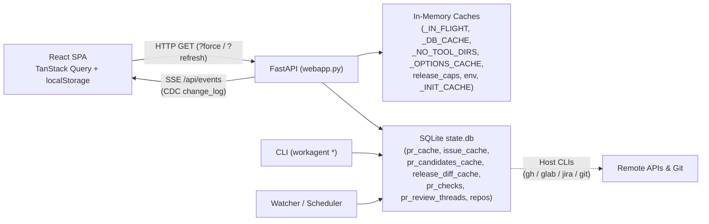

# Workagent Cache Architecture & Audit

> Last audited: 2026-11-23 (issue [#171](https://github.com/ynsr/workagent/issues/171))

This document catalogs every cache and caching coordinator across Workagent's backend (`src/workagent/`) and web frontend (`web/src/`): why each exists, how it works, how it affects user experience, its corner cases and known unknowns, and the prioritized bugs and improvements identified during the audit.

---

## 1. Architecture Overview

Workagent operates as two process models sharing one SQLite database (`~/.config/workagent/state.db`, WAL mode):

1. **Short-lived CLI invocations** (`workagent status`, `candidates`, `sync`, `cleanup`, `release`, etc.) that run for milliseconds to seconds and exit.
2. **Long-lived `workagent serve`** (FastAPI + uvicorn + background watcher/scheduler threads) serving the React SPA (`web/dist`) and pushing SQLite changes over `GET /api/events` (SSE backed by `change_log` CDC triggers).

Caching exists across four layers to shield both CLI and Web UX from slow external subprocesses (`git`, `gh`, `glab`, `jira`, ACP harness probes):

---

## 2. Environment Variable Reference

All TTL/SWR overrides are parsed by `swr.cache_ttl` / `swr.cache_swr` (`src/workagent/swr.py:54-83`). Invalid or negative values fall back to the default. Default SWR window is `max(ttl * 10, 86400)` (1 day floor).

| Env Variable | Default | Cache | Notes |
|---|---|---|---|
| `WORKAGENT_STATUS_TTL_SECONDS` | `259200` (3d) | `pr_cache` (positive PR) | **Bug:** currently unused as fresh TTL; planned to split open-PR (`WORKAGENT_STATUS_OPEN_TTL_SECONDS`, default 10m) vs terminal merged/closed (3d fresh / 30d SWR) |
| `WORKAGENT_STATUS_SWR_SECONDS` | `2592000` (30d) | `pr_cache` (positive PR) | Currently acts as hard TTL |
| `WORKAGENT_NEGATIVE_TTL_SECONDS` | `1800` (30m) | `pr_cache` (no PR) | **Bug:** currently unused as fresh TTL |
| `WORKAGENT_NEGATIVE_SWR_SECONDS` | `86400` (1d) | `pr_cache` (no PR) | Currently acts as hard TTL |
| `WORKAGENT_CI_TTL_SECONDS` | `600` (10m) | `pr_cache` (CI / reviews / issue status) | **Bug:** currently unused as fresh TTL |
| `WORKAGENT_CI_SWR_SECONDS` | `86400` (1d) | `pr_cache` (CI / reviews / issue status) | Currently acts as hard TTL |
| `WORKAGENT_ISSUES_TTL_SECONDS` | `3600` (1h) | `issue_cache` | Fresh TTL |
| `WORKAGENT_ISSUES_SWR_SECONDS` | `86400` (1d) | `issue_cache` | SWR window |
| `WORKAGENT_PRS_CACHE_TTL_SECONDS` | `600` (10m) | `pr_candidates_cache` | Fresh TTL |
| `WORKAGENT_PRS_CACHE_SWR_SECONDS` | `86400` (1d) | `pr_candidates_cache` | **Bug:** defined in `_prs_cache_swr()` but never checked |
| `WORKAGENT_RELEASE_DIFF_TTL_SECONDS` | `3600` (1h) | `release_diff_cache` | **Bug:** defeated by `background=True` always kicking `git fetch` |
| `WORKAGENT_RELEASE_DIFF_SWR_SECONDS` | `86400` (1d) | `release_diff_cache` | SWR window |
| `WORKAGENT_RELEASE_CAPS_TTL_SECONDS` | `600` (10m) | `release_caps._CACHE` | In-memory TTL |
| `WORKAGENT_STATUS_TIMEOUT` | `12` (12s) | Host-CLI timeout | Per-subprocess timeout |

---

## 3. Backend Caches (14 Mechanisms)

### 3.1 `pr_cache` (Persistent SQLite / Legacy JSON)
- **Locations:** `store_sqlite.py:49-50, 401`, `store.py:395-637`, `cli_repo_util.py:20-58`, `cli_status.py:58-481`, `watcher.py:42-92, 263, 300-313`, `cli_review.py:91-102`, `cli_sync.py:233-235`.
- **Why it exists:** Avoid calling `gh`/`glab`/`jira` per worktree on every `workagent status`, `link list`, `/api/status`, or `sync` call. Repeat runs should cost only two `git rev-parse` calls per worktree.
- **How it works:**
  - Table `pr_cache(branch TEXT PRIMARY KEY, payload TEXT, checked_at TEXT)` in `state.db` (fallback `pr_cache.json` before `workagent migrate`).
  - Key: `pr_cache_key(repo, branch) = f"{repo}\x1f{branch}"`, with read fallback to bare `branch`.
  - `payload` JSON stores PR metadata (`pr`, `tool`, `base_branch`, `branch_tip`, `base_tip`, `behind`, `ahead`), CI (`ci`, `ci_checked_at`, `ci_sha`, `ci_url`), review stats (`reviews`, `unresolved`, `resolved`, `reviews_checked_at`, `reviews_sha`), and linked issue status (`issue_status`, `issue_status_checked_at`).
  - Bypassed via `--refresh-pr` (CLI) or `?refresh=true` (Web `/api/status`).
- **Frontend UX impact:** Drives the main Dashboard `StatusTable` (PR state, CI badge, review count, Jira status) and `WorktreeDetail`/`WorktreeWorkspace` headers. Because SWR is unimplemented, remote merges, CI transitions (`running` → `failure`), new review comments, and Jira moves can stay stale for **1–30 days** unless the user manually clicks "Refresh PRs". Conversely, clicking "Refresh PRs" causes a full-table wipe/rewrite that emits `2N` CDC events and triggers redundant Dashboard refetches.
- **Corner cases:**
  - Gone worktrees (`branch_tip is None`) store `ci_sha=""` / `reviews_sha=""`, which never equals `None`, causing a cache miss on every status call.
  - `refresh_pr=True` with unchanged git tips does not update `base_branch` or ahead/behind counts if the PR's target branch changed remotely.
  - `_query_pr` failure falls back to stale `cached["pr"]` and calls `cache_pr_status(...)`, resetting `checked_at` to `now` and extending stale data's lifetime indefinitely.
  - Writing CI/review/issue status for a key not yet in `pr_cache` stamps `checked_at = now` even though PR status was never queried.
  - Entries are never pruned when worktrees are cleaned up, hard-deleted, or garbage-collected.
- **Known unknowns:**
  - Actual `pr_cache` table size on long-lived installations (unbounded growth across deleted branches).
  - Frequency of `sqlite3.OperationalError: database is locked` during concurrent `watcher` + `serve` + CLI writes (raw `sqlite3.connect` without `busy_timeout`).

### 3.2 `issue_cache` (Persistent SQLite)
- **Locations:** `store_sqlite.py:77-79, 2297-2330`, `trackers.py:677-749`, `cli_candidates.py:183-208, 342-345`, `webapp.py:860-896`.
- **Why it exists:** Jira (`jira issue list`) and GitHub (`gh issue list`) queries take 1–5s each; caching per `(source, scope, days)` makes the Candidates tab and Launch issue picker responsive.
- **How it works:**
  - Table `issue_cache(source TEXT PRIMARY KEY, payload TEXT, fetched_at TEXT)`.
  - Key: `f"{source}:{'mine' if mine else 'all'}{max(1, int(days))}"` (e.g., `jira:mine90`, `github:all365`).
  - Fresh TTL 1h, SWR window 1d. Uses `swr.serve_stale_or_refresh` when `ttl <= age < swr`.
  - Cleared only by `workagent candidates --reset-cache`; bypassed via `force=True`.
- **Frontend UX impact:** Drives `CandidatesCard` Issues tab and `Launch`/`StartForm` issue selectors. Because `issue_cache` has no CDC trigger, background SWR refreshes never push to the UI. Worse, `CandidatesCard` passes `force=true` whenever "Last year" or "All Issues" is selected, bypassing this cache entirely.
- **Corner cases:**
  - `if not cached or not fetched_at:` treats legitimate empty list `[]` as a cache miss → live query on every request.
  - `_jira_my_issues` / `_gh_my_issues` swallow errors and return `[]`; `_live()` overwrites previously valid cached rows with `[]`.
  - `_live` captures the caller's `warn: list` and mutates it from a background thread after the HTTP response has serialized.
  - Arbitrary `days` (1–365) keys accumulate without pruning; tracker domain/enablement edits (`POST /api/tracker-domains`) do not invalidate it.
- **Known unknowns:**
  - Whether background threads in short-lived `workagent candidates` CLI runs have ever left partial/aborted refreshes on process exit.

### 3.3 `pr_candidates_cache` (Persistent SQLite)
- **Locations:** `store_sqlite.py:80-82, 2332-2357`, `cli_candidates.py:116-182`, `webapp.py:880-887`.
- **Why it exists:** Listing open PRs/MRs across all registered repos (`gh pr list` / `glab mr list` per repo) blocks the Candidates Unlinked PR/MRs tab for several seconds.
- **How it works:**
  - Single-row table `pr_candidates_cache(source TEXT PRIMARY KEY, payload TEXT, fetched_at TEXT)` with `source="prs"`.
  - Fresh TTL 10m; `_prs_cache_swr()` (1d) is defined but never checked.
  - Only read/written by `GET /api/candidates/prs`; CLI `workagent candidates` and `GET /api/candidates` bypass it completely.
- **Frontend UX impact:** Drives `CandidatesCard` Unlinked PR/MRs tab. Because `_linked_sets()` filtering happens before caching (not on read) and there is no invalidation on `start`/`review`/`register`, newly linked PRs remain visible as "Unlinked" for up to 10 minutes (or 24h in TanStack Query). Clicking Refresh cannot force-refresh because `/api/candidates/prs` lacks a `force` parameter.
- **Corner cases:**
  - Empty `[]` is treated as a cache miss (`if cached and fetched_at:`).
  - SWR window is never enforced — months-old non-empty rows are still served as stale.
  - Network/CLI failure across all repos writes `[]` over valid cached PRs.
  - `--reset-cache` does not clear `pr_candidates_cache`.
- **Known unknowns:**
  - None beyond multi-repo rate-limit behavior when `[]` causes repeated live fetches.

### 3.4 `release_diff_cache` (Persistent SQLite)
- **Locations:** `store_sqlite.py:83-85, 2358-2383`, `repos_release.py:163-176, 223-344`, `cli_release.py:190, 200-220`, `webapp.py:904-909`.
- **Why it exists:** Counting commits `origin/<release>..origin/<default>` requires `git fetch origin` per repo; caching keeps `ReleaseCard` non-blocking.
- **How it works:**
  - Table `release_diff_cache(repo_key TEXT PRIMARY KEY, count INTEGER, fetched_at TEXT)`.
  - Fresh TTL 1h, SWR window 1d. Correctly caches `0` (`cached is not None`). Invalidated on release merge (`_invalidate_diff_cache_by_path`).
- **Frontend UX impact:** Drives Dashboard `ReleaseCard`. Two bugs undermine the non-blocking design: (1) `refs_ci.fetch_branch_ci(...)` runs **synchronously with zero caching** on every `/api/release/status` call, and (2) when `background=True` and the cache is **fresh**, `repos_release.py:303-312` still kicks a background `git fetch origin`, so 30s frontend polling runs `git fetch` on every repo every 30 seconds.
- **Corner cases:**
  - Keyed only by `repo_key`, not `(repo_key, default_branch, release_branch)` — `repo update` changing branches serves stale counts.
  - Not deleted on `repo remove`.
  - When `force=True`, `cached` is not loaded, losing offline stale fallback; offline fallback also leaves `fetched_at` as `None`.
  - `_behind_count` runs local `git rev-list` on every call (not cached alongside `count`).
- **Known unknowns:**
  - How much GitHub/GitLab API quota is consumed by uncached `fetch_branch_ci` running every 30s per repo while the Dashboard is open.

### 3.5 `pr_checks` & `pr_review_threads` (Persistent SQLite)
- **Locations:** `store_sqlite.py:136-159, 1989`, `store_timeline.py:53-202`, `cli_status.py:241-265, 325-349, 399-418`, `watcher.py:78-90, 315-326`, `webapp.py:358-380`.
- **Why they exist:** Persist normalized per-check CI results and PR review threads for the Worktree Feedback Timeline (`GET /api/worktrees/{ref}/timeline`) and auto-watcher triggers.
- **How they work:**
  - Foreign-keyed to `worktrees(ref_key) ON DELETE CASCADE`. Replaced atomically per worktree via `DELETE` + `INSERT` in one transaction.
  - No independent TTL — freshness is coupled to `_ci_cell` / `_reviews_cell` in `cli_status.py` and `watcher._refresh_worktree_inputs`.
- **Frontend UX impact:** Because `_ci_cell` / `_reviews_cell` inherit `pr_cache`'s 1d `_ci_swr()` bug and neither table is in `CDC_TABLES`, the Worktree Timeline can stay stale for up to 1d unless `WORKAGENT_WATCH=1` or manual `--refresh-pr` is run, and relies on a fixed 15s poll.
- **Corner cases:** Empty returns from mocked/errored fetchers can wipe existing rows if `replace_pr_checks(key, [])` is called unconditionally.
- **Known unknowns:** Whether partial API responses from `gh`/`glab` can intermittently return empty lists without raising.

### 3.6 `repos.tool` & `repos.remote` (Persistent SQLite / Config)
- **Locations:** `cli_repo_util.py:69-112`, `store_sqlite.py:25-34`, `repos.py:440-473`.
- **Why it exists:** Avoid probing `gh`/`glab` config files and auth status on every PR/MR operation.
- **How it works:** Persisted on the `repos` table (`tool`, `remote`). Reused while `entry["tool"] in ("gh", "glab")` and `entry["remote"] == repos.remote_url(Path(repo))`. Self-heals when `origin` URL changes.
- **Corner cases:** Calls `store.load_repos()` + `git remote get-url origin` on every `_repo_tool()` call. If `_detect_host_cli` returns `None` (e.g., due to `_NO_TOOL_DIRS` or transient auth probe failure), `tool=None` can be persisted over a previously valid tool if `remote` changed or was unset.
- **Known unknowns:** None.

### 3.7 `swr._IN_FLIGHT` & `swr.serve_stale_or_refresh` (In-Memory Coordinator)
- **Locations:** `swr.py:89-128`.
- **Why it exists:** Deduplicate concurrent background refreshes per cache key across HTTP requests in `workagent serve`.
- **How it works:** Module-level `_IN_FLIGHT: set[str]` guarded by `_LOCK = threading.Lock()`. Spawns a `daemon=True` thread per key.
- **Corner cases:**
  - **API footgun (`swr.py:125-128`):** Passing `is_fresh=True` falls through to `return refresh(), False` (runs `refresh()` inline instead of returning `stale`!).
  - **Silent failures (`swr.py:103-104`):** `except Exception: pass` discards all background errors with zero logging.
  - **Short-lived CLI hazard:** Daemon threads spawned during CLI commands are killed mid-flight at interpreter exit.
  - **No inline single-flight:** Concurrent cold misses or `force=True` requests all run `refresh()` in parallel.
- **Known unknowns:** Whether silent background exceptions have been masking recurring `gh`/`glab`/`jira` or SQLite errors in production `serve` logs.

### 3.8 `cli_repo_util._DB_CACHE` (In-Memory Dict)
- **Locations:** `cli_repo_util.py:15, 60-66`.
- **Why it exists:** Memoize `repos.default_branch(Path(repo))` (`git symbolic-ref`) per repo path.
- **How it works:** Unbounded module-level `dict[str, str]`, no lock, no TTL, no invalidation.
- **Corner cases:** Permanently negative-caches `""` on transient `HarnessError` for the entire lifetime of `workagent serve`; never updates if a repo's default branch changes.

### 3.9 `repos._NO_TOOL_DIRS` (In-Memory Set)
- **Locations:** `repos.py:437-473`.
- **Why it exists:** Avoid repeatedly running slow `gh`/`glab auth status` probes for local-only repos with no matching remote host.
- **How it works:** Unbounded module-level `set[str]`, no lock, no TTL, no invalidation.
- **Corner cases:** Permanent for the lifetime of `workagent serve` — a transient timeout/offline probe or later `gh auth login` / `git remote add origin` never recovers until server restart.

### 3.10 `release_caps._CACHE` (In-Memory Dict)
- **Locations:** `release_caps.py:15-22, 82-107`.
- **Why it exists:** Cache GitHub/GitLab branch-protection & merge-strategy capability probes (`ff-push`, `mr-ff`, `merge-commit`).
- **How it works:** Keyed by `(tool, path, release_branch)` with 10m TTL (`WORKAGENT_RELEASE_CAPS_TTL_SECONDS`). Invalidated on merge rejection (`cli_release.py:406`).
- **Corner cases:** No lock, no stampede protection, returns mutable reference `hit[1]` directly, and `_gh_caps` swallows non-auth `HarnessError` and caches `pr_required: False` for 10m.

### 3.11 `web_runs_routes._OPTIONS_CACHE` (In-Memory Dict)
- **Locations:** `web_runs_routes.py:450-489, 948`.
- **Why it exists:** Probing ACP harness models/efforts spawns a subprocess (`omp`/`agy`); caching avoids repeated probes when opening Launch / Worktree composer.
- **How it works:** Keyed by `harness_name`, hardcoded 600s TTL (not env-overridable), bypassed with `?refresh=1`. Errors are not cached.
- **Corner cases:** No lock or single-flight (concurrent cold opens spawn parallel ACP subprocesses); shallow `dict(hit[1])` shares nested lists; `now` captured before probe latency; expired probe failure does not fall back to last-known options.

### 3.12 `env._SOURCED_CACHE` (In-Memory Dict)
- **Locations:** `env.py:108-165`.
- **Why it exists:** Avoid spawning `bash -c 'source env.sh; env -0'` on every command/harness launch.
- **How it works:** Keyed by `str(Path(env_file).expanduser()) -> (mtime_ns, diff_dict)`. Falls back to stale on error.
- **Corner cases:** No lock; only checks `env.sh`'s own `mtime_ns`, missing edits to transitively `source`d files (e.g., `~/.secrets/.env`) or dynamic proxy-port detection; diffs against `os.environ` at first call.
- **Known unknowns:** How often users edit sourced secret files or restart local proxies while `workagent serve` is running.

### 3.13 `store_sqlite._INIT_CACHE` (In-Memory Dict)
- **Locations:** `store_sqlite.py:1883, 2017-2095`.
- **Why it exists:** Skip running 30+ schema migrations on every DB access.
- **How it works:** Maps `str(db_path) -> True`, plus global `"backfill"` / `"backfill:started"` flags.
- **Corner cases:**
  - `init_db()` (`line 2017`) calls `_schema_current(path)` — opening a new read-only SQLite connection and running ~20 `PRAGMA` queries — **on every single DB helper call**, defeating the fast path.
  - Lock-retry exhaustion (`line 2064-2071`) forgets `last = e` and executes `raise None` (`TypeError`).
  - Backfill flags are global instead of per-DB-path and unlocked.

### 3.14 `backend.HARNESSES` & `web_runs.Registry` (In-Memory Singletons/Buffers)
- **`backend.HARNESSES`** (`backend.py:128-158`): Lazy singleton registry for `omp`/`agy`. Bounded, benign unlocked init.
- **`web_runs.Registry`** (`web_runs.py`): Lock-protected in-memory run state & log buffer (`MAX_RUNS = 100`, `MAX_LINES = 10_000`). Bounded and thread-safe; included for completeness.

---

## 4. Frontend Caches, Persistence & Reactivity (`web/src/`)

### 4.1 TanStack Query v5 (`web/src/lib/query.ts`, `web/src/lib/queries.ts`)
- Global defaults: `retry: 1`, `staleTime: 5_000`, `refetchOnWindowFocus: true`, `gcTime: 300_000`, `mutations.retry: false`.
- **Bucketed `staleTime` policies:**
  - **30 days:** `statusAll`, `statusInactive`, `statusDeleted` (poll 15s / 60s with SSE).
  - **24 hours:** `flows` (poll 15s / 60s), `candidatesPrs`, `candidatesIssues`, `candidatesWorktrees`, `issues`, `candidates`.
  - **1 hour:** `releaseStatus` / `releaseStatuses` (fixed 30s poll, ignores SSE).
  - **10 min:** `harnessOptions`.
  - **5s–60s:** `runs` (poll 10s / 60s), `worktreeTimeline` (fixed 15s poll), `info`, `config`, `path`, `repos`, `trackers`, `links`, `prodtests`, `messages`, `worktreeDiff`, `schedules`, etc.
- **UX issues:**
  - `refetchOnWindowFocus: true` is **dead** on 30d/24h/1h queries (TanStack Query v5 only refetches *stale* queries on focus unless `"always"`).
  - `Dashboard.tsx:191-193` mounts `useStatusAll()`, `useStatusInactive()`, and `useStatusDeleted()` simultaneously, firing **3 concurrent `/api/status` calls** even though `include_inactive=true&include_deleted=true` is a superset of the other two.

### 4.2 Global CDC SSE (`web/src/hooks/useServerEvents.ts`) & Per-Run SSE (`useRunEvents.ts`)
- Subscribes to `GET /api/events` for `CDC_TABLES` (`worktrees`, `runs`, `flows`, `messages`, `pr_cache`, `prodtest_items`, `schedules`).
- **UX issues:**
  - No debouncing/coalescing: a bulk `pr_cache` update fires N events and triggers repeated refetches right after `handleRefreshPr` lands.
  - Missing CDC coverage for `pr_candidates_cache`, `issue_cache`, `release_diff_cache`, `repos`, `trackers`, `pr_checks`, `pr_review_threads` → background SWR updates and CLI mutations never push to UI.
  - `WorktreeWorkspace.tsx:90` calls `useRunEvents` without syncing terminal state to `useRun` cache.

### 4.3 `localStorage` (10 keys) & Ad-Hoc Component Caches
- Keys: `theme`, `workagent.verbose`, `workagent.showWorktree`, `workagent.dashboardView`, `workagent.confirm.optout`, `workagent.issuesFilter` (`settings.ts`); `launch.prefs.v1`, `launch.startByRepo.v1` (`launchPrefs.ts`); `release.prefs.v1` (`releasePrefs.ts`); `workagent-sidebar-collapsed` (`AppLayout.tsx`). No cross-tab `storage` event listener.
- `SearchableSelect.tsx:40-64` caches `api.issues()` forever in `loadedRef` per mount instead of sharing TanStack Query's cache.
- `WorktreeWatcherOverrides.tsx:23-32` fetches via raw `useEffect` + `useState` outside TanStack Query.

---

## 5. Prioritized Bug & Improvement Catalog

### Critical (6)
1. **`pr_cache` wipe-and-rewrite + lost-update race + CDC storm + missing `busy_timeout`** (`store.py:420-437`) → Replace with atomic per-row `INSERT ... ON CONFLICT DO UPDATE` via `sq.connect(db)` + single-row `lookup_pr_cache`.
2. **`pr_cache` SWR unimplemented (1–30d hard TTLs)** (`cli_status.py:58-431`) → Enforce fresh TTLs (10m open PR / 30d merged-closed / 30m negative / 10m CI-reviews-issue), serve stale + background refresh in `serve`, safe non-spawning stale read in CLI.
3. **`watcher.py` wrong `pr_cache` key & JSON path** (`watcher.py:64-65, 300-313`) → Use `store.lookup_pr_cache(branch, repo)` and read `cached["pr"]["url"]`.
4. **`CandidatesCard` passes `needsBroad` as `force=true`** (`CandidatesCard.tsx:76-93`) → Pass `force=false` so prefetch and backend 1h cache actually work.
5. **`CandidatesCard` Refresh writes to orphaned key & can't force-refresh PRs** (`CandidatesCard.tsx:110-133`, `webapp.py:880-887`) → Add `?force=true` to `/api/candidates/prs`, write refreshed data into the subscribed `"cached"` keys (`setQueryData`), and pass `staleTime: 0`.
6. **`CandidatesCard` 0ms `prsStale` auto-refetch loop gives up** (`CandidatesCard.tsx:55-64`) → Remove the 0ms hack; rely on `pr_candidates_cache` CDC trigger pushing updates automatically.

### High (7)
7. **Empty-list `[]` negative-cache bug** in `pr_candidates_cache` & `issue_cache` (`cli_candidates.py:157, 174`, `trackers.py:736`) → Check `cached is not None and fetched_at` instead of truthiness.
8. **Transient errors overwrite good cached rows with `[]`** (`cli_candidates.py:166-172`, `trackers.py:717-728`, `cli_status.py:192-208`) → Track per-source success; never overwrite non-empty cache on total failure; never bump `checked_at` on stale fallback.
9. **`pr_candidates_cache` ignores SWR, leaks newly-linked PRs, bypassed by CLI/`/api/candidates`** (`cli_candidates.py:122-181, 224`) → Enforce `_prs_cache_swr()`, filter `_linked_sets()` on read, share cache with `/api/candidates`, clear on `--reset-cache`.
10. **`release_status` blocks on uncached CI fetch + triggers `git fetch` when fresh + incomplete key** (`repos_release.py:266-312`) → Cache branch CI in `release_diff_cache` (10m TTL + SWR), only kick background refresh when stale, key by `(repo_key, default_branch, release_branch)`, add `?force=true`, preserve `fetched_at` on offline fallback.
11. **`swr.py` footguns** (`swr.py:93-128`, `trackers.py:746`) → Fix `is_fresh=True` to return `(stale, False)` without calling `refresh()`, log background exceptions, add `allow_background: bool` (False in CLI, True in `serve`), isolate background `warn` list in `trackers.py`, propagate `stale` flag.
12. **Dashboard triple `/api/status` fetch + dead `refetchOnWindowFocus` + CDC storm** (`Dashboard.tsx:191-193, 269-284`, `queries.ts:53-96`) → Single `/api/status?include_inactive=true&include_deleted=true` query with `select` projections + debounced CDC invalidations.
13. **Systematic missing invalidations & CDC gaps** (`store_sqlite.py:396-404`, `useServerEvents.ts`, `queries.ts:390-402`, `Trackers.tsx`, `Launch.tsx`, `WorktreeDetail.tsx`, `RunDetail.tsx`, `Settings.tsx`) → Expand `CDC_TABLES` + complete `invalidateAfterRun` & mutation handlers.

### Medium (7)
14. **Permanent negative caches** (`repos._NO_TOOL_DIRS`, `cli_repo_util._DB_CACHE`) → Add TTL (e.g., 5m for negative, 10m for positive default branch) + lock.
15. **`store_sqlite._INIT_CACHE` runs ~20 PRAGMAs per DB call + `raise None` bug** (`store_sqlite.py:2017, 2064-2071`) → Trust `_INIT_CACHE[str(path)]` after first verification (invalidate only on reset/new file), assign `last = e`, scope backfill flags per `str(path)` under lock.
16. **`env._SOURCED_CACHE` misses transitive `source`d edits** (`env.py:108-165`) → Add lock + short TTL (e.g., 60s) alongside `mtime_ns` check so sourced secret/proxy changes are picked up without restarting `serve`.
17. **`pr_cache` & `issue_cache` unbounded growth** → Prune `pr_cache` row on worktree cleanup/hard-delete/purge-orphans; prune `issue_cache` entries older than SWR window on write.
18. **`release_caps._CACHE` & `web_runs_routes._OPTIONS_CACHE` concurrency & leakage** → Add locks, single-flight, `copy.deepcopy`, post-probe timestamp, stale fallback on probe error, stop caching non-auth GH error as `pr_required: False`.
19. **`useRun("")` bogus request + `WorktreeWorkspace` SSE state lag** (`queries.ts:301-303`, `WorktreeWorkspace.tsx:90`) → Add `enabled: Boolean(id)` and sync terminal SSE state in `WorktreeWorkspace`.
20. **`ReleaseCard` UX & ad-hoc fetches** (`ReleaseCard.tsx`, `SearchableSelect.tsx`, `WorktreeWatcherOverrides.tsx`, `RunWatcher.tsx`, `Dashboard.tsx:779`, `CandidatesCard.tsx:180`) → Add manual Refresh button + accurate overlay on `ReleaseCard`, back `SearchableSelect` & `WorktreeWatcherOverrides` with TanStack Query, fix `RunWatcher` multi-completion toast, align stale UI copy.
