# Workagent Improvement Roadmap & Actionable Issue Catalog

**Issue:** [ynsr/workagent#126](https://github.com/ynsr/workagent/issues/126)  
**Companion Report:** [Agent Orchestrator vs. Workagent: Architecture, Data Modeling & UI/UX Analysis](./agent-orchestrator-vs-workagent-analysis.md)  
**Baseline Verified Against `main` (`bdd1809`):** Includes the ACP harness implementation from [PR #123 (`#112`)](https://github.com/ynsr/workagent/pull/123) and the ACP fixes, validation, and transcript/UI alignment from [PR #129 (`#128`)](https://github.com/ynsr/workagent/pull/129), [PR #131 (`#130`)](https://github.com/ynsr/workagent/pull/131), and [PR #133 (`#132`)](https://github.com/ynsr/workagent/pull/133) (`AcpHarness`, `OmpAcpHarness`, `AgyAcpHarness`, 4 execution modes `preview | headless | acp | terminal` across CLI/web/flow/release/message commands, `GET /api/harnesses/{name}/options?refresh=0|1`, `POST /api/runs/{id}/input` via `WORKAGENT_RUN_DIR/input.jsonl` with strict `pending_question`/`qid` validation, `Structured / Raw` toggle in `RunDetail.tsx`, and `AcpTranscript` with chunk coalescing, `toolCallId` merging, `
` for thoughts & tool calls, `react-markdown` + `remark-gfm`, formatted `usage`, and `QuestionCard`).

---

## 1. Strategic Overview: How to Evolve Workagent

`OrchestratorInc/agent-orchestrator` (AO) demonstrates how a multi-agent engineering tool can feel like a **calm, high-signal precision instrument** rather than an administrative table console. At the same time, **Workagent** already possesses critical enterprise capabilities that AO lacks: **declarative multi-step Flow Templates**, **Jira state-machine transitions**, **Mattermost chat message ingestion & reply drafting**, **multi-repo child worktrees (`--related-repo`)**, **release-branch management (`Ready to release` / `fix-default`)**, and **post-release production verification (`Prodtests`)**.

The improvements below bring AO's best architectural and UI/UX patterns into Workagent **without losing Workagent's CLI-first parity (`test_specs_mirror_cli_flags`) or enterprise workflow strengths**.

---

## 2. Backend Improvements

### B1. Data Modeling & SQLite Structure (`src/workagent/store_sqlite.py`)

| # | Current Limitation in Workagent | AO Pattern | Proposed Workagent Improvement |
|---|---|---|---|
| **B1.1** | **Opaque `pr_cache` JSON blob (`store_sqlite.py:47-48`)**: PR metadata, aggregate CI state, and review counts are stored in a single JSON string keyed by branch. Individual failing CI checks, check log tails, and unresolved review comment threads cannot be queried or displayed inline in the UI without opening GitHub/GitLab. | Relational `prs`, `pr_checks`, `pr_review_threads`, and `pr_comments` tables with semantic hashes (`metadata_hash`, `ci_hash`, `review_hash`) and `last_nudge_signature`. | Add normalized **`pr_checks`** (`worktree_ref`, `pr_url`, `name`, `commit_sha`, `status`, `conclusion`, `url`, `log_tail`, `checked_at`) and **`pr_review_threads`** (`worktree_ref`, `pr_url`, `thread_id`, `author`, `file`, `line`, `body`, `resolved`, `is_bot`, `updated_at`) tables (or structured columns/views alongside `pr_cache`). |
| **B1.2** | **No Unified Per-Worktree Activity / Feedback Ledger**: Worktree events are scattered across `runs`, `flows`, `pr_cache`, and `prodtest_items`. There is no chronological timeline showing how a worktree progressed from `Start → PR Opened → CI Failed → Fix Run → Review Comment → Commit Pushed → Ready to Merge`. | `conversation_activities`, `change_log`, and `InspectorActivityTimelineView` (`feedback.jpg`) record every SCM observation, routed nudge, and agent turn in sequence. | Add a **`worktree_events`** table (`id`, `worktree_ref` FK `ON DELETE CASCADE`, `kind` [`run_started`\|`run_finished`\|`flow_step`\|`ci_failed`\|`ci_passed`\|`review_comment`\|`nudge_routed`\|`commits_pushed`\|`issue_transition`\|`prodtest`], `actor`, `summary`, `detail_json`, `run_id` FK, `created_at`). |
| **B1.3** | **Trigger-Based Change Data Capture (`change_log`)**: Frontend pages poll `/api/status` every 15s and `/api/runs` every 1.5–4s independently. | SQLite triggers append row mutations into `change_log(seq, project_id, session_id, event_type, payload)` tailed by a single SSE broadcaster (`GET /api/v1/events`). | Add lightweight SQLite `AFTER INSERT/UPDATE/DELETE` triggers on `worktrees`, `runs`, `flows`, `messages`, and `prodtest_items` writing to a bounded **`change_log`** table, powering a single global `GET /api/events` SSE invalidation endpoint. |
| **B1.4** | **No Token / Cost / Duration Telemetry on `runs`**: `runs` records `exit_code` and `output`, but not token counts, cost, or turn duration emitted by ACP `usage_update` events or `agy`/`omp` stream-json transcripts. | `conversations` and `model_usage_events` track `usage_input_tokens`, `usage_output_tokens`, `usage_cached_tokens`, `usage_cost`, and `duration_ms`. | Add **`duration_ms`**, **`input_tokens`**, **`output_tokens`**, **`cached_tokens`**, **`cost_usd`**, and **`model_id`** columns to `runs` (populated automatically at run completion from ACP `usage` events / headless JSON output). |
| **B1.5** | **No First-Class Parent-Child Run Lineage for Flows & Sub-Runs**: `runs.flow_id` links a run to a `flows` row, and `runs.continued_from_run_id` links transcript chains, but when `workagent flow run` spawns a top-level web run (`flow run ...`) that in turn spawns child step runs (`start`, `review`, `fix_comments`), the child runs are not linked via `parent_run_id`. | `sessions` and `conversation_activities` track parent/child hierarchy so sub-runs fold cleanly under their parent. | Add **`parent_run_id INTEGER REFERENCES runs(id) ON DELETE SET NULL`** and **`step_index INTEGER`** to `runs` so `RunsTable` and `FlowDetail` can fold step runs directly under their parent flow run. |

---

### B2. Functionality & Features (`src/workagent/`)

1. **Derived Delivery Stage & Attention Status Reducer (`src/workagent/delivery_status.py`)**:
   - Mirror AO's `contract/kanban.go` (`DeriveKanbanPresentation`): compute two deterministic fields at read time for every worktree in `GET /api/status` (and `workagent status --json`):
     - `kanban_column`: `"working" | "needs_you" | "in_review" | "ready_to_merge"`
     - `display_status`: Human-readable actionable phrase (e.g., `"Working · Start"`, `"Flow step 2/5 · Review"`, `"Waiting for your answer"`, `"Flow paused at step 1"`, `"CI failed · pytest"`, `"3 unresolved review comments"`, `"Behind base by 5 commits"`, `"Approved · Ready to merge"`, `"Merged · Pending prodtest"`).
   - **Precedence rules**:
     1. **`needs_you`**: Active run in `state == "needs_input"` or with `pending_question` (ACP `ask_question`), paused flow (`flows.status == "paused"`), last run `failed`, CI `failure` (with no active auto-fix run), or `unresolved > 0` review threads (with no active fix run).
     2. **`working`**: Live harness on worktree (`harness != ""`), active `running` run, or `running` flow.
     3. **`ready_to_merge`**: Open PR with `ci == "success"` (or passing), `unresolved == 0`, and `behind == 0` (or merged PR ready for cleanup/prodtest).
     4. **`in_review`**: Open PR awaiting human review or with `ci == "running"`.
2. **Closed-Loop Auto-Watchers (`auto_fix_ci`, `auto_fix_reviews`, `auto_sync`)**:
   - In AO (`feedback.jpg`), when a PR check fails or a reviewer leaves comments, the daemon's `SCMObserver` automatically routes the failure log or review thread back into the worker session.
   - Add per-repo and per-worktree opt-in flags (`auto_fix_ci`, `auto_fix_reviews`) backed by a background watcher task inside `workagent serve` (and callable via `workagent watch [--once]`):
     - Polls open PRs on active worktrees with `LastNudgeSignature` deduplication (`(head_sha, ci_status, unresolved_thread_ids)`).
     - When CI transitions to `failure` on a new SHA and no harness is currently live on the worktree, automatically dispatches an ACP/headless fix run with the failing job URL and log tail, and records a `nudge_routed` event in `worktree_events`.
     - When new unresolved review comments arrive on the PR, automatically dispatches `workagent review <ref> --fix-comments --use-review-session` in ACP/headless mode.
3. **Multi-Turn ACP Session Continuity & Mid-Turn Steering (`POST /api/runs/{id}/follow-up`)**:
   - PR #123 and PR #129 wire `WORKAGENT_RUN_DIR/input.jsonl` so `QuestionCard` can answer an active `ask_question` tool call (`POST /api/runs/{id}/input` now strictly enforces `409 no_pending_question` / `qid_mismatch` / `not_running`).
   - Extend `AcpHarness` with `session/load` resume (and optional keep-alive / interactive follow-up mode) plus a dedicated `POST /api/runs/{id}/follow-up` endpoint so users can send follow-up instructions or mid-turn **Steer** messages from the `RunDetail` / `WorktreeWorkspace` chat composer even when the agent didn't explicitly call `ask_question`.
4. **In-App Git Diff & File Inspection API (`GET /api/worktrees/{ref}/diff`)**:
   - Add read-only endpoints `GET /api/worktrees/{ref}/files` (list of modified/added/deleted files with `+additions/-deletions` against `base_branch` or `HEAD`) and `GET /api/worktrees/{ref}/diff?path=<file>&mode=base|head` so the web UI can render syntax-highlighted unified/split diffs and let operators send inline line-level annotations directly to an `adhoc` or `acp` run.
5. **Conversational Project Orchestrator Mode (`workagent orchestrate`)**:
   - Complement deterministic `Flow Templates` with an optional conversational **Orchestrator Mode**: a project/multi-repo ACP agent session given safe `workagent` CLI/API tools (`workagent status --json`, `workagent candidates --json`, `workagent start <ref> --acp`, `workagent review <ref> --acp`, `workagent flow run`) that can decompose a high-level feature request or Mattermost thread into 2–4 parallel worktree runs and render a live `Started N workers` card.
6. **Built-in Recurring Schedules (`schedules` table & daemon loop)**:
   - Inspired by AO's `Automations`, allow scheduling any Workagent `Flow Template`, `Custom Action`, or `prodtest run --all` / `cleanup --merged` on a cron/RRULE schedule with timezone support and run history inside `workagent serve`.

---

### B3. Architecture & Design Patterns

1. **Global SSE Event Bus (`GET /api/events`)**:
   - Consolidate client polling (`useStatusAll` 15s, `useRuns` 1.5s, `useFlows`, `useReleaseStatus` 30s) into a single `EventSource("/api/events")` connection that emits lightweight invalidation events (`{"type": "worktree.updated", "ref": "..."}`, `{"type": "run.updated", "id": "..."}`, `{"type": "flow.updated", "id": "..."}`) with `Last-Event-ID` watermark replay from `change_log`.
2. **Code-Generated TypeScript API Schema**:
   - FastAPI natively generates an OpenAPI 3.1 schema (`app.openapi()`). Add a dev script and pytest drift test (mirroring `test_specs_mirror_cli_flags` and AO's `npm run api`) that exports `openapi.json` from `webapp.create_app()` and generates `web/src/lib/api-schema.d.ts`, eliminating manual drift between `webapp.py` responses and `web/src/lib/api.ts`.

---

## 3. Frontend (UI/UX) Improvements Across the 5 Dimensions

### F1. User Interface Design & Usability

1. **Consolidate Sidebar Navigation from 15 Items down to 7 Core Destinations**:
   - **Current Problem**: `AppLayout.tsx` has 15 top-level links (`Dashboard`, `Launch`, `Messages`, `Message Launch`, `Flows`, `Runs`, `Prodtests`, `Prodtest Launch`, `Flow Templates`, `Actions`, `Repos`, `Trackers`, `Links`, `Doctor`, `Settings`). Three of those (`Launch`, `Message Launch`, `Prodtest Launch`) are standalone form pages with ~50% empty horizontal whitespace, and `Links` duplicates `StatusTable` + `CandidatesCard` from `Dashboard`.
   - **Target Information Architecture (7 items)**:
     1. **Board / Worktrees (`/`)**: Unified Dashboard with `Board | Table` view switcher, inline `+ New Task / Launch` drawer, `Candidates` drawer/section, and `Ready to Release` bar.
     2. **Runs & Flows (`/runs`)**: Unified execution center with tabs or split views for `Active & Recent Runs` (hierarchical tree) and `Flow Runs`.
     3. **Messages (`/messages`)**: Registered Mattermost threads + slide-over/inline `Message Launch` drawer (`Adhoc`, `Validate`, `Draft reply`, `Action`, `Flow`).
     4. **Prodtests (`/prodtests`)**: Post-release verification ledger + inline/drawer `Plan / Run Prodtest` launcher and YAML plan viewer.
     5. **Automation Library (`/library`)**: Unified 2-tab page combining `Flow Templates` and `Custom Actions` (plus recurring `Schedules`).
     6. **Repositories & Trackers (`/repos`)**: Unified configuration surface combining `Repos`, `Trackers`, and `Tracker ↔ Repo Mappings` (replacing the redundant `/links` page).
     7. **System & Settings (`/settings`)**: Unified settings rail combining `General / Theme / Default Harness`, `Confirmations`, and `Doctor / Service Health`.
   - *(Keep existing URL routes `/launch`, `/message-launch`, `/prodtest-launch`, `/flow-templates`, `/actions`, `/trackers`, `/links`, `/doctor` working via redirects or pre-opened drawers/tabs so bookmarks never break.)*
2. **Remove Raw API Subtitles & Visual Chrome Clutter**:
   - Strip developer-facing `<CardDescription>GET /api/messages</CardDescription>`, `GET /api/flows`, `GET /api/flow-templates`, `GET /api/prodtests` subtitles from user-facing cards (or show them only when `Verbose` / Developer mode is enabled in Settings).
   - Replace wide 13-column management tables (`FlowTemplates.tsx`, `Actions.tsx`) and raw absolute file paths in `Prodtests.tsx` (`/.workagent/prodtest/plans/IPG-1069.yaml` shown as a compact `IPG-1069.yaml · rev3` pill with full path on tooltip/copy) so zero horizontal scrollbars appear at `1280px–1440px` desktop widths.
3. **Global Command Palette (`⌘K` / `Ctrl+K`)**:
   - Add a `cmdk`-powered `CommandPalette.tsx` reachable from anywhere via `⌘K` / `Ctrl+K` and a sidebar search button:
     - Jump to any active/deactivated/deleted worktree by issue key, branch, or PR number.
     - Run any `Flow Template` or `Custom Action` on a worktree in 2 keystrokes.
     - Quick-launch `Start from issue`, `Review PR`, `Sync all`, `Release repo`, or `Search runs/messages`.

---

### F2. Management of Workflows & Tasks

1. **Kanban Delivery Board View on Dashboard (`Board | Table` Toggle)**:
   - Add a segmented view switcher (`Board` | `Table`) to `Dashboard.tsx` (persisted in `localStorage`).
   - **4 Semantic Lanes** (modeled directly on AO's `board.jpg` and `SessionsBoardView.tsx`):
     1. **`Working`** (Blue dot `#60a5fa`): Worktrees with a live AI harness (`agy`/`omp`), running web run, or running flow step.
     2. **`Needs you`** (Coral/Amber dot `#f06445`): Worktrees with an ACP `pending_question`, a `needs_input` (exit 2) run, a `paused` flow, a `failed` run, failing CI check (`ci === "failure"`), or unresolved PR review comments (`unresolved > 0`). Sorted to the top with a subtle attention border.
     3. **`In review`** (Amber dot `#f59e0b`): Open PRs with CI running (`ci === "running"`) or awaiting reviewer approval.
     4. **`Ready to merge / ship`** (Green dot `#4ade80`): Approved/clean PRs (`ci === "success"`, `unresolved === 0`, `behind === 0`) or merged PRs awaiting cleanup/release/prodtest.
   - **Card Anatomy (`WorktreeBoardCard.tsx`)**:
     - Harness avatar (`AGY` / `OMP`) + Issue key & title (or PR title) + quick hover action menu.
     - Monospace branch topic + multi-repo child worktree badge (`+2 related repos`).
     - Compact PR pill (`#123 open`), CI check badge, unresolved review comment counter, and Prodtest pill.
     - Bottom status bar showing the derived `display_status` phrase (`"Flow step 2/5: Reviewing"`, `"Asking question (ACP)"`, `"CI failed"`, `"Ready to merge"`), live spinner when active, and relative timestamp.
2. **Visual Stepper Pipeline Progress Bar for Flows**:
   - Replace the plain text `step 0` / `step 5` cell in `Flows.tsx` and `StatusTable` with a compact horizontal **Step Pill Bar** (`Start ✓ → Review ● → Fix ○ → Cleanup ○`) showing at a glance which step is running, paused, or failed, with a one-click inline `Resume` button when paused.

---

### F3. Integration with AI Agents & Orchestration

1. **Dedicated Worktree Workspace View (`/worktrees/:ref` or Slide-Over Split Inspector)**:
   - Currently, clicking a worktree row on the Dashboard only expands a small metadata tray (`WorktreeDetail.tsx`), while live agent output lives on a separate `/runs/:runId` page.
   - Introduce a unified **Worktree Workspace View** (modeled on AO's `SessionView` + `SessionInspectorRail`):
     - **Left/Center Pane**: Live ACP Chat / Transcript surface (`AcpTranscript` + `QuestionCard` from PR #123 / PR #129) + persistent bottom **Prompt Composer** (`HarnessSelect`, `RunModeSelect`, `ModelSelect`, `EffortSelect`, and prompt input) to send follow-up instructions, run a custom action, or trigger a flow step in place without navigating away to `/launch`.
     - **Right Inspector Rail (Tabbed)**:
       1. `Summary & Timeline`: Issue/PR metadata, `Behind|Ahead` sync status, CI checks, and the chronological **Feedback & Activity Timeline** (`feedback.jpg`).
       2. `Files & Diff`: In-app Git diff viewer (`GET /api/worktrees/{ref}/diff`) with inline line-comment annotations that can be dispatched directly to the agent.
       3. `Flows & Runs`: All flow executions and historical runs scoped to this worktree.
       4. `Prodtest`: Embedded YAML test plan preview and latest verification results for this issue.
2. **Inline Slide-Over Launch Drawers (Eliminating Full-Page Form Detours)**:
   - Clicking `+ New Task` on the Dashboard, `+ Run on Message` on `/messages`, or `Plan / Run` on `/prodtests` should open a responsive **Slide-Over Drawer / Modal** right over the current list context (preserving scroll and table state underneath), while keeping deep-link URLs (`?launch=start&ref=...`) shareable.

---

### F4. Visualization of Agent Interactions & Task Progress

1. **Category-Aggregated Tool Call Folding (`ActivityRun` in `AcpTranscript.tsx`)**:
   - Building directly on PR #123 and PR #129 (which already landed chunk coalescing, `toolCallId` merging, `
` for thoughts and individual tool calls, Markdown rendering, and the `Structured / Raw` toggle): when an ACP agent emits a sequence of 3+ consecutive exploratory tool calls (`read`, `search`, non-mutating `execute`/`bash`), automatically group them into a single collapsible summary line:
     > `▸ Explored 14 files, 5 searches, 3 commands · +42 −11`
   - Keep **failed tool calls** (`status === "failed"` / `"error"` or non-zero exit code) automatically extracted and visible immediately below the folded summary line (mirroring AO's `FailedCalls` component in `ActivityRun.tsx`) so errors are never hidden inside collapsed disclosures.
   - Prefix every completed agent turn/run with `"Worked for <duration> · <model> (<effort>)"` and token/cost summary pills when available.
2. **Closed-Loop Feedback Timeline Component (`WorktreeFeedbackTimeline.tsx`)**:
   - Inspired directly by AO's `feedback.jpg`, render a vertical chronological timeline inside the Worktree Workspace / Detail view that interleaves:
     - **CI Failure Events**: `✕ CI failed on <job>` → `+ routed to <harness> (run #db-1998)`
     - **PR Review Events**: `💬 <author> left <N> review comments` → `+ routed to review-fix session`
     - **Agent Fix Events**: `🤖 <harness> pushed <N> commits to <branch>` → `+ <files changed>, comments resolved`
     - **Ready State**: `✓ Checks passing, 0 unresolved threads — Ready to merge` with an inline **`Merge & Cleanup`** or **`Run Release Flow`** button.
3. **Hierarchical Parent-Child Run Tree in `RunsTable.tsx`**:
   - In `Screenshot From 2026-11-20 23-51-18.png`, a single `flow run workagent_start_to_cleanup` produces 3–4 flat rows (`db-1997`, `db-1996`, `db-1995`, `13bf871a80`).
   - Group child step runs under their parent `Flow` run row with an expand/collapse chevron (`▸ Flow: workagent_start_to_cleanup (step 2/5 running)`), hiding child noise by default while allowing 1-click drill-down into any step's transcript.

---

### F5. Responsiveness & Accessibility

1. **Responsive Table-to-Card Adaptation & Zero Horizontal Overflow**:
   - Replace horizontal-scrolling 10–13 column tables on `FlowTemplates`, `Actions`, `Prodtests`, and `Messages` with compact composite cells (e.g., grouping boolean flags `Protected`, `Top Bar`, `Overlay` into a single `Placements & Lock` icon group; truncating `Prodtests` plan paths to `IPG-1069.yaml · rev3` with a copy/preview button).
   - At `<md` viewports, automatically render `StatusTable` rows as stacked `WorktreeBoardCard` items.
2. **Keyboard Navigation & Shortcut System (`useHotkeys`)**:
   - Global `⌘K` / `Ctrl+K` Command Palette.
   - Contextual `/` or `⌘F` to focus the current page's search/filter input (`Dashboard`, `Runs`, `Messages`, `Prodtests`).
   - `j` / `k` or `↑` / `↓` arrow-key navigation across `StatusTable` rows and `Board` cards, `Enter` to open the Worktree Workspace/Detail, `c` for Cleanup, `s` for Sync, `r` for Review.
   - Full focus trap and trigger-focus restoration on all custom dialogs (`ActionDialog.tsx`) and drawers.
3. **Motion & Screen Reader Resilience**:
   - Honor `prefers-reduced-motion` across all pulsing indicators, detail reveals, and drawer transitions; restrict continuous animations to compositor-only `transform` and `opacity`.
   - Provide `.sr-only` descriptive labels for compact metrics (`Behind|Ahead` `1|6` → `"1 commit behind, 6 commits ahead of base branch"`, `Reviews` `0 · 0 of 0` → `"0 reviews, 0 unresolved comments"`).

---

## 4. Prioritized Implementation Roadmap & Issue Catalog

The roadmap is structured into **4 Phased Waves (14 Actionable Issues)** that can be filed directly in `ynsr/workagent` to execute these improvements systematically.

```mermaid
flowchart LR
    subgraph Wave1["Wave 1: Core UX & Board Foundation"]
        I1["Issue 1: Derived Delivery Stage & Kanban Board View"]
        I2["Issue 2: Navigation Consolidation (15 → 7) & Slide-Over Launch Drawers"]
        I3["Issue 3: Global Cmd+K Command Palette & Keyboard Shortcuts"]
        I4["Issue 4: Table Density Polish & Zero Horizontal Overflow"]
    end
    subgraph Wave2["Wave 2: Rich ACP Workspace & Activity Grouping"]
        I5["Issue 5: ActivityRun Tool-Call Folding & Turn Summary in AcpTranscript"]
        I6["Issue 6: Hierarchical Parent-Child Run Tree & Visual Flow Stepper"]
        I7["Issue 7: Worktree Workspace View & Multi-Turn ACP Follow-up Composer"]
        I8["Issue 8: In-App Git Diff Viewer & Inline Line Annotations"]
    end
    subgraph Wave3["Wave 3: Closed-Loop Feedback & Event-Driven Backend"]
        I9["Issue 9: Normalized PR Checks/Threads & Worktree Feedback Timeline"]
        I10["Issue 10: SQLite CDC change_log & Global /api/events SSE Stream"]
        I11["Issue 11: Closed-Loop Auto-Watchers (auto_fix_ci & auto_fix_reviews)"]
    end
    subgraph Wave4["Wave 4: Advanced Orchestration, Scheduling & Telemetry"]
        I12["Issue 12: Run Token/Cost/Duration Telemetry & Usage Dashboard"]
        I13["Issue 13: Built-in Cron/RRULE Schedules for Flows & Actions"]
        I14["Issue 14: Conversational Multi-Worktree Orchestrator Agent Mode"]
    end
    Wave1 --> Wave2 --> Wave3 --> Wave4
```

---

### Ready-to-Create GitHub Issues Catalog

#### Issue 1: Add derived delivery stage (`kanban_column`, `display_status`) and Kanban Board view to Dashboard
- **Scope**: Backend (`src/workagent/cli.py`, `src/workagent/delivery_status.py`, `web/API_CONTRACT.md`) + Frontend (`web/src/pages/Dashboard.tsx`, `web/src/components/WorktreeBoard.tsx`).
- **Problem**: `StatusTable` requires scanning 10 columns horizontally and does not visually separate worktrees that are actively running an agent from those blocked waiting on the human (`needs_input`, ACP `pending_question`, paused flow, failing CI, unresolved review comments) or ready to merge.
- **Solution**:
  1. Add a pure read-time reducer `derive_delivery_status(entry, active_runs, active_flows)` returning `kanban_column` (`working | needs_you | in_review | ready_to_merge`) and a concise `display_status` phrase (e.g. `"Working · Review"`, `"Waiting for your answer"`, `"Flow paused · step 2"`, `"CI failed"`, `"2 unresolved comments"`, `"Approved · Ready to merge"`).
  2. Expose `kanban_column` and `display_status` in `workagent status --json` and `GET /api/status`.
  3. Add a `Board | Table` segmented toggle on `Dashboard.tsx` (persisted in `localStorage`) rendering a 4-lane Kanban board (`Working`, `Needs you`, `In review`, `Ready to merge`) with attention sorting, harness badges, branch/PR/CI pills, and quick actions.
- **Acceptance Criteria**:
  - `pytest` unit tests covering every precedence branch of `derive_delivery_status`.
  - `vitest` tests for `WorktreeBoard` lane placement, attention highlighting, and `Board | Table` toggle persistence.

#### Issue 2: Consolidate sidebar navigation (15 → 7 items) and convert standalone Launch pages into contextual slide-over drawers
- **Scope**: Frontend (`web/src/components/layout/AppLayout.tsx`, `web/src/pages/*`, `web/src/components/LaunchDrawer.tsx`).
- **Problem**: The sidebar has 15 top-level links across 7 groups. `Launch`, `Message Launch`, and `Prodtest Launch` are standalone pages with right-aligned cards and ~50% empty whitespace; `/links` duplicates `Dashboard`'s `StatusTable` and `CandidatesCard`.
- **Solution**:
  1. Consolidate sidebar navigation to 7 task-oriented destinations: `Dashboard (/)`, `Runs & Flows (/runs)`, `Messages (/messages)`, `Prodtests (/prodtests)`, `Automation Library (/library)` (tabbed `Flow Templates` | `Actions`), `Repos & Trackers (/repos)` (tabbed `Repos` | `Trackers` | `Mappings`), and `Settings (/settings)` (tabbed `Settings` | `Doctor`).
  2. Embed `Launch`, `Message Launch`, and `Prodtest Launch` as slide-over drawers/modals directly triggerable from `Dashboard`, `Messages`, and `Prodtests`, while keeping `/launch`, `/message-launch`, `/prodtest-launch`, `/flow-templates`, `/actions`, `/trackers`, `/links`, and `/doctor` routes working seamlessly.
- **Acceptance Criteria**:
  - Sidebar displays 7 primary/secondary items; all existing URL routes continue to resolve and pass router tests.

#### Issue 3: Add global Command Palette (`⌘K` / `Ctrl+K`) and keyboard navigation shortcuts
- **Scope**: Frontend (`web/src/components/CommandPalette.tsx`, `web/src/hooks/useHotkeys.ts`, `web/src/components/layout/AppLayout.tsx`).
- **Problem**: Navigating between worktrees, launching flows/actions, or filtering tables requires mouse clicks across multiple screens.
- **Solution**:
  1. Add a global `⌘K` / `Ctrl+K` Command Palette indexing active/deactivated/deleted worktrees, registered repositories, flow templates, custom actions, recent runs, and navigation routes.
  2. Add keyboard shortcuts: `/` or `⌘F` to focus the current view's search bar; `j`/`k` to move selection across worktree rows/cards; `Enter` to open detail; `s` to Sync; `r` to Review; `c` to Cleanup (when no input is focused).
- **Acceptance Criteria**:
  - `vitest` tests verifying `⌘K` open/close, fuzzy filtering, worktree action dispatch, and shortcut suppression when typing in inputs/textareas.

#### Issue 4: UI density polish — remove raw `GET /api/...` card subtitles and eliminate horizontal table overflow
- **Scope**: Frontend (`web/src/pages/Flows.tsx`, `FlowTemplates.tsx`, `Actions.tsx`, `Messages.tsx`, `Prodtests.tsx`, `Repos.tsx`, `Trackers.tsx`).
- **Problem**: Cards display developer subtitles (`GET /api/messages`, `GET /api/flow-templates`, `GET /api/prodtests`), and wide tables on `FlowTemplates` (13 columns) and `Prodtests` (full `/home/bs/dev/worktrees/.../.workagent/prodtest/plans/IPG-1069.yaml` path) force horizontal scrollbars on standard desktop screens.
- **Solution**:
  1. Hide raw `GET /api/...` endpoint descriptions unless `Verbose` mode is enabled in Settings.
  2. In `Prodtests.tsx`, format `plan_path` as a compact `IPG-1069.yaml · rev3 · <risk>` badge with a tooltip and copy/preview action for the full path.
  3. In `FlowTemplates.tsx` and `Actions.tsx`, group the `Protected`, `Top`, `Overlay`, and `Order` columns into a compact trailing control cluster so the table fits comfortably without horizontal scrolling.

#### Issue 5: Add `ActivityRun` multi-tool folding, `FailedCalls` extraction, and settled turn summaries to `AcpTranscript`
- **Scope**: Frontend (`web/src/components/AcpTranscript.tsx`, `web/src/lib/harness.ts`, `web/src/pages/RunDetail.tsx`) — follow-up to PR #123 (`ff8b1ab`) and PR #129 (`bdd1809`).
- **Problem**: PR #129 landed per-block chunk coalescing, `toolCallId` merging, `
` for thoughts and individual tool calls, Markdown rendering, formatted `usage` text, and the `Structured / Raw` toggle. However, long exploratory runs still render dozens of sequential individual tool-call `
` rows without category grouping, and completed turns lack a summary header showing elapsed duration and model/effort.
- **Solution**:
  1. Group 3+ consecutive exploratory tool calls (`read`, `search`, non-mutating `execute`/`bash`) into a single collapsible `ActivityRun` summary bar: `"Explored N files, M searches, K commands"` with aggregate `+additions/-deletions` badges when file edits occurred, while surfacing any **failed** tool call unfolded immediately beneath (`FailedCalls`).
  2. Show a settled turn header (`"Worked for <duration> · <model> (<effort>)"`) at the top of each completed turn (using turn timing / run metadata).
  3. Preserve sticky user expand/collapse overrides and `Follow output` autoscroll behavior across live updates.

#### Issue 6: Hierarchical parent-child run tree in `RunsTable` and visual stepper progress bar in `Flows`
- **Scope**: Backend (`src/workagent/store_sqlite.py`, `src/workagent/cli_flow_run.py`) + Frontend (`web/src/components/RunsTable.tsx`, `web/src/pages/Flows.tsx`, `web/src/components/StatusTableMain.tsx`).
- **Problem**: Running a flow spawns a top-level `flow run` row plus multiple child step runs (`start`, `review`, `fix_comments`) that appear as flat, ungrouped rows in `Runs.tsx`. In `Flows.tsx`, progress is shown only as plain text `step 0` or `step 5`.
- **Solution**:
  1. Record `parent_run_id` and `step_index` on child runs spawned by `flow run` (and link `flow_id` consistently).
  2. In `RunsTable.tsx`, nest child step runs under their parent flow run with an expand/collapse toggle and live step counter.
  3. In `Flows.tsx` and `StatusTableMain.tsx`, render a visual step pill bar (`Start ✓ → Review ● → Fix ○ → Cleanup ○`) with inline `Resume` / `Skip step` controls when paused.

#### Issue 7: Dedicated Worktree Workspace View (`/worktrees/:ref`) with multi-turn ACP follow-up composer
- **Scope**: Backend (`src/workagent/acp_harness.py`, `src/workagent/web_runs_routes.py`) + Frontend (`web/src/pages/WorktreeWorkspace.tsx`, `web/src/components/WorktreeDetail.tsx`).
- **Problem**: Supervising an agent on a worktree requires jumping between `Dashboard`, `Launch`, `Flows`, and `RunDetail`. Additionally, as of `main` (`bdd1809`, PR #123 / PR #129), `AcpHarness.launch_acp` still always calls `session/new` (no `session/load` resume yet) and exits whenever no `question` event is pending (always true for `omp`), while `POST /api/runs/{id}/input` strictly requires an active `pending_question` (`409 no_pending_question` / `409 not_running`).
- **Solution**:
  1. Persist the ACP `sessionId` in `runs.metadata`, add `session/load` resume support (and optional keep-alive mode) to `AcpHarness.launch_acp`, and expose `POST /api/runs/{id}/follow-up` so finished ACP runs can continue seamlessly in-place.
  2. Create a split-pane **Worktree Workspace View** (`/worktrees/:ref`):
     - **Center Pane**: Live `AcpTranscript` + `QuestionCard` + bottom **Follow-up Prompt Composer** (allowing the user to send a follow-up prompt or trigger `Review` / `Fix comments` / `Sync` / `Custom Action` in-place on the worktree).
     - **Right Inspector Rail**: Tabs for `Summary & Timeline`, `Diff / Files`, `Flows & Runs`, and `Prodtest`.

#### Issue 8: In-app Git Diff Viewer, Prodtest YAML Plan Viewer, and Inline Line Annotations
- **Scope**: Backend (`src/workagent/webapp.py`, `src/workagent/git_diff.py`) + Frontend (`web/src/components/WorkspaceDiffView.tsx`, `web/src/components/ProdtestPlanViewer.tsx`).
- **Problem**: Operators cannot inspect what files an agent modified in a worktree or read a generated `.workagent/prodtest/plans/<KEY>.yaml` file inside the web UI without switching to an external terminal or IDE.
- **Solution**:
  1. Add `GET /api/worktrees/{ref}/diff` (returning changed file summaries + unified diff hunks against `base_branch` or uncommitted working tree) and `GET /api/prodtests/{issue_key}/plan` (returning the validated YAML content).
  2. Build `WorkspaceDiffView.tsx` (unified/split toggle, syntax highlighting, and `+` line comment boxes that batch inline review annotations into an `adhoc` or `acp` fix prompt on that worktree).
  3. Build `ProdtestPlanViewer.tsx` modal/tab on `Prodtests.tsx` and `WorktreeWorkspace.tsx`.

#### Issue 9: Normalized PR checks & review threads storage + Closed-Loop Worktree Feedback Timeline
- **Scope**: Backend (`src/workagent/store_sqlite.py`, `src/workagent/refs.py`) + Frontend (`web/src/components/WorktreeFeedbackTimeline.tsx`).
- **Problem**: `pr_cache` stores only a single aggregate `ci` string (`success|failure|running`) and aggregate `reviews_detail` counts (`{reviews, unresolved, resolved}`). Users cannot see which specific CI check failed or read unresolved review comments in Workagent, nor see a chronological history of the feedback loop (`feedback.jpg`).
- **Solution**:
  1. Persist individual failing/running check names & URLs and unresolved review comment summaries (author, file:line, body snippet) in `pr_cache` / `pr_checks` / `pr_review_threads` and record state transitions in `worktree_events`.
  2. Render `WorktreeFeedbackTimeline.tsx` (modeled on AO's `feedback.jpg`) showing chronological CI failures, review comments, routed agent fix runs, pushed commits, and merge readiness.

#### Issue 10: SQLite trigger-based `change_log` (CDC) and global `GET /api/events` SSE invalidation stream
- **Scope**: Backend (`src/workagent/store_sqlite.py`, `src/workagent/webapp.py`, `src/workagent/cdc.py`) + Frontend (`web/src/hooks/useServerEvents.ts`, `web/src/lib/queries.ts`).
- **Problem**: The web UI polls `/api/status` every 15s, `/api/runs` every 1.5–4s, and `/api/release/status` every 30s. State transitions made via the CLI or background flows take up to 15s to reflect on the Dashboard.
- **Solution**:
  1. Add SQLite triggers on `worktrees`, `runs`, `flows`, `messages`, `pr_cache`, and `prodtest_items` inserting into a bounded `change_log(seq, table_name, row_key, op, created_at)` table.
  2. Expose `GET /api/events` (SSE with `Last-Event-ID` support) broadcasting change notifications.
  3. Subscribe once in `AppLayout` (`useServerEvents`) to invalidate exact TanStack Query keys (`statusAll`, `runs`, `flows`, `messages`, `prodtests`) immediately on mutation, reducing background polling frequency to a 60s safety fallback.

#### Issue 11: Closed-loop background PR & CI auto-watchers (`auto_fix_ci` and `auto_fix_reviews`)
- **Scope**: Backend (`src/workagent/watcher.py`, `src/workagent/store_sqlite.py`, `src/workagent/webapp.py`) + Frontend (`web/src/pages/Repos.tsx`, `web/src/components/WorktreeDetail.tsx`).
- **Problem**: When CI fails on a PR or a teammate posts review comments on GitHub/GitLab, a human must manually click `Fix comments` or run a flow in Workagent.
- **Solution**:
  1. Add opt-in `auto_fix_ci` and `auto_fix_reviews` toggles per repo (`repos` table) and per worktree (`worktrees.payload`).
  2. Run a background observer loop in `workagent serve` (and `workagent watch` CLI subcommand) that checks active worktrees with open PRs, deduplicates via `last_nudge_signature = sha256(head_sha + ci_state + unresolved_ids)`, skips worktrees with an active harness lock or paused flow, and automatically spawns an ACP/headless fix run when new CI failures or review comments appear.

#### Issue 12: Capture run token, cost, model, and duration telemetry and add Usage summary view
- **Scope**: Backend (`src/workagent/store_sqlite.py`, `src/workagent/acp_harness.py`, `src/workagent/agy_harness.py`, `src/workagent/webapp.py`) + Frontend (`web/src/lib/harness.ts`, `web/src/pages/Runs.tsx`, `web/src/pages/RunDetail.tsx`).
- **Problem**: `acp_harness.py` emits `{"t": "usage", "id": ..., "usage": ...}` events on stdout (`acp_harness.py:511-513`) and PR #129 formats them inline via `formatUsage()` in `web/src/lib/harness.ts`, but the backend still does not persist `duration_ms`, `model_id`, `effort`, or token/cost metrics into `runs` in `state.db`, and `RunsTable` / `RunDetail` / `Runs.tsx` do not surface aggregated run duration, model/effort badges, or token/cost totals.
- **Solution**:
  1. Add `duration_ms`, `model_id`, `effort`, `input_tokens`, `output_tokens`, `cached_tokens`, and `cost_usd` to `runs` in `state.db`.
  2. Populate these fields from `AcpHarness` `{"t": "usage", "usage": ...}` events and headless stream-json summaries on run completion.
  3. Display persisted duration, model/effort badges, and token/cost pills on `RunsTable`, `RunDetail`, and a compact usage summary bar on `Runs.tsx`.

#### Issue 13: Add built-in recurring Cron/RRULE Schedules for Flow Templates, Custom Actions, and Maintenance commands
- **Scope**: Backend (`src/workagent/store_sqlite.py`, `src/workagent/scheduler.py`, `src/workagent/cli_schedule.py`, `src/workagent/webapp.py`) + Frontend (`web/src/pages/FlowTemplates.tsx`).
- **Problem**: Routine operations like `review --all`, `cleanup --merged`, `prodtest run --all`, or daily issue/message triage flows cannot be scheduled directly inside Workagent.
- **Solution**:
  1. Add a `schedules` table (`id`, `name`, `cron_expr`, `timezone`, `target_kind` [`flow`|`action`|`command`], `target_label`, `args_json`, `enabled`, `last_run_at`, `next_run_at`, `last_run_id`).
  2. Add `workagent schedule add|list|update|remove|run-due` CLI subcommands and a background scheduler loop in `workagent serve`.
  3. Add a `Schedules` tab inside the Automation Library UI with starter templates (`Daily unreviewed PR review`, `Daily merged worktree cleanup`, `Post-release prodtest sweep`).

#### Issue 14: Add Conversational Project Orchestrator Mode (`workagent orchestrate`)
- **Scope**: Backend (`src/workagent/cli_orchestrate.py`, `src/workagent/webapp.py`) + Frontend (`web/src/components/OrchestratorChat.tsx`).
- **Problem**: While deterministic `Flow Templates` excel at structured pipelines for a known issue ref, operators sometimes want to describe a multi-part goal or paste a complex Mattermost thread and let a coordinator agent inspect the repositories, split the work across multiple issues/branches/repos, and spawn parallel worker runs.
- **Solution**:
  1. Add `workagent orchestrate [--repo R...] [--prompt P]` launching an ACP coordinator session equipped with a scoped `workagent` skill/toolset (`workagent status --json`, `workagent candidates --json`, `workagent message show`, `workagent start <ref> --acp`, `workagent flow run <tpl> <ref>`).
  2. In the web UI, render a `Started N workers` card (modeled on AO's `orchestrator.jpg` / `SpawnedAgents`) whenever an orchestrator run spawns child worktree runs, showing live status spinners and direct links to each spawned worktree workspace.
