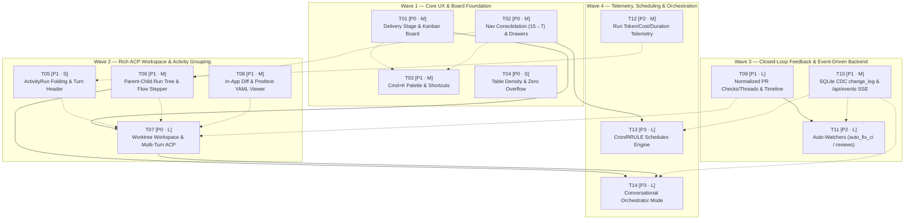

# Workagent Improvement Tasks & Sub-Tasks Plan

**Issue:** [ynsr/workagent#126](https://github.com/ynsr/workagent/issues/126)  
**Baseline:** `main` (`bdd1809` — includes PR #123 ACP harness, PR #129 ACP fixes & transcript UI, PR #131 OMP discovery/cascade fixes, PR #133 step-0 flow retry)  
**Companion Docs:**
- [Architecture, Data Modeling & UI/UX Analysis](./agent-orchestrator-vs-workagent-analysis.md)
- [Improvement Roadmap & Actionable Issue Catalog](./workagent-improvement-roadmap.md)

---

## 1. Priority, Effort & Dependency Legend

| Priority | Meaning |
|---|---|
| **P0** | Core UX/architecture foundation — highest daily operator ROI; unblocks downstream workspace and navigation work |
| **P1** | High-leverage supervision & workflow upgrades — directly closes the biggest AO vs. Workagent workflow gaps |
| **P2** | Event-driven reactivity, closed-loop automation, and telemetry — turns Workagent from poll-driven to self-healing |
| **P3** | Advanced orchestration & scheduling — builds on mature ACP, workspace, and watcher primitives |

| Effort | Typical Scope | Dependency Type | Notation |
|---|---|---|---|
| **S** | ≤ 1 day (single layer, localized) | **Hard dependency** | Must merge first (API, schema, or component contract required) |
| **M** | 2–3 days (cross-layer or multi-page) | **Soft dependency** | Can be built independently; integrates richer data/UI when available |
| **L** | 4–5 days (schema + daemon loop + UI) | | |

---

## 2. Master Task Matrix (14 Parent Tasks)

| ID | Roadmap Ref | Title | Wave | Priority | Effort | Layer | Hard Deps | Soft Deps | Parallel Track |
|---|---|---|---|---|---|---|---|---|---|
| **T01** | Issue 1 | Derived delivery stage (`kanban_column`, `display_status`) & Dashboard Kanban Board | Wave 1 | **P0** | M | BE + FE | — | — | Track A (Dashboard/UX) |
| **T02** | Issue 2 | Sidebar navigation consolidation (15 → 7) & slide-over Launch drawers | Wave 1 | **P0** | M | FE | — | — | Track B (Shell/Nav) |
| **T03** | Issue 3 | Global Command Palette (`⌘K` / `Ctrl+K`) & keyboard navigation shortcuts | Wave 1 | **P1** | M | FE | — | T01, T02 | Track C (Shortcuts) |
| **T04** | Issue 4 | UI density polish — hide raw `GET /api/...` subtitles & eliminate table overflow | Wave 1 | **P0** | S | FE | — | — | Track D (Polish) |
| **T05** | Issue 5 | `ActivityRun` multi-tool folding, `FailedCalls` extraction & turn summaries in `AcpTranscript` | Wave 2 | **P1** | S | FE | — | T12 | Track E (ACP Transcript) |
| **T06** | Issue 6 | Hierarchical parent-child run tree in `RunsTable` & visual Flow stepper | Wave 2 | **P1** | M | BE + FE | — | T02 | Track F (Flows/Runs) |
| **T07** | Issue 7 | Worktree Workspace View (`/worktrees/:ref`) & multi-turn ACP follow-up composer | Wave 2 | **P0** | L | BE + FE | T01 | T05, T06, T08, T09 | Track A (Workspace) |
| **T08** | Issue 8 | In-app Git Diff Viewer, Prodtest YAML Plan Viewer & inline line annotations | Wave 2 | **P1** | M | BE + FE | — | — | Track G (Diff/Files) |
| **T09** | Issue 9 | Normalized PR checks & review threads + Worktree Feedback Timeline | Wave 3 | **P1** | L | BE + FE | — | — | Track H (SCM Ledger) |
| **T10** | Issue 10 | SQLite trigger-based `change_log` (CDC) & global `GET /api/events` SSE stream | Wave 3 | **P1** | M | BE + FE | — | — | Track I (Realtime CDC) |
| **T11** | Issue 11 | Closed-loop background PR & CI auto-watchers (`auto_fix_ci`, `auto_fix_reviews`) | Wave 3 | **P2** | L | BE + FE | T09 | T10 | Track H (Auto-Watchers) |
| **T12** | Issue 12 | Persisted run token, cost, model & duration telemetry + Usage summary bar | Wave 4 | **P2** | M | BE + FE | — | — | Track J (Telemetry) |
| **T13** | Issue 13 | Built-in recurring Cron/RRULE Schedules for Flows, Actions & Maintenance | Wave 4 | **P3** | L | BE + FE | T02 | T10 | Track K (Scheduler) |
| **T14** | Issue 14 | Conversational Multi-Worktree Orchestrator Mode (`workagent orchestrate`) | Wave 4 | **P3** | L | BE + FE | T06, T07 | T10 | Track A (Orchestrator) |

---

## 3. Transparent Dependency Graph

Solid arrows (`-->`) are **hard dependencies** (must complete first). Dashed arrows (`-.->`) are **soft integrations** (optional enrichment; tasks remain independently shippable).

### Critical Path vs. Parallel Execution Plan
- **Critical Path (longest hard chain):** `T01` → `T07` → `T14` (Worktree delivery status → Worktree Workspace + multi-turn ACP → Conversational Orchestrator).
- **Secondary Hard Chains:**
  - `T09` → `T11` (Normalized PR checks/review threads & event ledger → Closed-loop auto-watchers).
  - `T02` → `T13` (Consolidated Automation Library `/library` → Schedules tab).
  - `T06` → `T14` (`parent_run_id` lineage → Orchestrator `Started N workers` tree).
- **Zero-Dependency Starters (can all run in parallel on Day 1):**
  `T01`, `T02`, `T03`, `T04`, `T05`, `T06`, `T08`, `T09`, `T10`, `T12` have **no hard prerequisites** — teams or parallel agents can execute Wave 1 (`T01`–`T04`) alongside independent backend foundations (`T06`, `T08`, `T09`, `T10`, `T12`) without blocking.

---

## 4. Detailed Tasks & Sub-Tasks

---

### Wave 1: Core UX & Board Foundation

#### T01: Derived delivery stage (`kanban_column`, `display_status`) & Dashboard Kanban Board
- **Priority:** P0 | **Wave:** 1 | **Effort:** M | **Layer:** Backend + Frontend
- **Depends on:** None (Hard) | **Unblocks:** T07 (Hard), T03 (Soft)
- **Sub-tasks:**
  - [ ] **T01.1** *(BE)* — Create pure reducer `src/workagent/delivery_status.py::derive_delivery_status(entry, active_runs, active_flows)` returning `{"kanban_column": "working"|"needs_you"|"in_review"|"ready_to_merge", "display_status": str, "attention_reason": str | None}` with strict precedence (`needs_you` > `working` > `ready_to_merge` > `in_review`).
    - *Verify:* `uv run pytest tests/test_delivery_status.py -v` covering every precedence branch (ACP `pending_question`, `needs_input`, paused flow, failed run, CI failure, unresolved comments, live harness, clean PR, merged PR).
  - [ ] **T01.2** *(BE)* — Wire `kanban_column`, `display_status`, and `attention_reason` into `src/workagent/cli_status.py`, `src/workagent/cli_status_cells.py`, `src/workagent/webapp.py` (`GET /api/status`), and document in `web/API_CONTRACT.md` & `web/src/lib/api.ts`.
    - *Verify:* `uv run pytest tests/test_cli_status.py tests/test_webapp_data.py -v`.
  - [ ] **T01.3** *(FE)* — Build `web/src/components/WorktreeBoard.tsx` and `WorktreeBoardCard.tsx`: 4 semantic lanes (`Working`, `Needs you`, `In review`, `Ready to merge`) with attention-first sorting, coral attention border on `Needs you`, harness badge (`AGY`/`OMP`), branch/PR/CI/review/prodtest pills, derived `display_status` footer, `.sr-only` metric labels, and quick hover actions.
    - *Depends on:* T01.2
    - *Verify:* `cd web && npm test -- WorktreeBoard`.
  - [ ] **T01.4** *(FE)* — Add `Board | Table` segmented switcher (persisted in `localStorage`) to `web/src/pages/Dashboard.tsx`, preserving `WorktreeFilterForm` + `RepoTabs` across both views and auto-switching to stacked cards below `md` breakpoint.
    - *Depends on:* T01.3
    - *Verify:* `cd web && npm test -- Dashboard && npm run typecheck`.

---

#### T02: Consolidate sidebar navigation (15 → 7) & convert Launch pages into slide-over drawers
- **Priority:** P0 | **Wave:** 1 | **Effort:** M | **Layer:** Frontend
- **Depends on:** None (Hard) | **Unblocks:** T13 (Hard), T03 & T06 (Soft)
- **Sub-tasks:**
  - [ ] **T02.1** *(FE)* — Create reusable slide-over drawer primitive (`web/src/components/LaunchDrawer.tsx`) with focus trap, `Esc` close, trigger-focus restoration, and `prefers-reduced-motion` support.
    - *Verify:* `cd web && npm test -- LaunchDrawer`.
  - [ ] **T02.2** *(FE)* — Embed `Start/Review/Sync/Adhoc/Flow` launch forms inside a `LaunchDrawer` triggered from `Dashboard.tsx` (`+ New Task`), `MessageLaunch` drawer inside `Messages.tsx` (`+ Run on Message`), and `ProdtestLaunch` drawer inside `Prodtests.tsx` (`Plan / Run`).
    - *Depends on:* T02.1
    - *Verify:* `cd web && npm test -- Dashboard Messages Prodtests`.
  - [ ] **T02.3** *(FE)* — Create unified tabbed container pages:
    - `Runs & Flows` (`/runs` with `Runs | Flows` tabs),
    - `Automation Library` (`/library` with `Flow Templates | Actions` tabs),
    - `Repos & Trackers` (`/repos` with `Repos | Trackers | Mappings` tabs),
    - `Settings` (`/settings` with `General | Doctor` tabs).
    - *Verify:* `cd web && npm run typecheck && npm test`.
  - [ ] **T02.4** *(FE)* — Collapse `web/src/components/layout/AppLayout.tsx` sidebar from 15 links to 7 destinations while preserving backward-compatible route redirects/pre-opened tabs for `/launch`, `/message-launch`, `/prodtest-launch`, `/flows`, `/flow-templates`, `/actions`, `/trackers`, `/links`, `/doctor`.
    - *Depends on:* T02.2, T02.3
    - *Verify:* `cd web && npm test && npm run build`.

---

#### T03: Global Command Palette (`⌘K` / `Ctrl+K`) & keyboard navigation shortcuts
- **Priority:** P1 | **Wave:** 1 | **Effort:** M | **Layer:** Frontend
- **Depends on:** None (Hard); T01 & T02 (Soft — indexes Board actions & consolidated routes)
- **Sub-tasks:**
  - [ ] **T03.1** *(FE)* — Create `web/src/hooks/useHotkeys.ts` with input/textarea/contenteditable suppression and `Mod+K`, `/`, `Mod+F`, `j`/`k`, `Enter`, `s` (Sync), `r` (Review), `c` (Cleanup) bindings.
    - *Verify:* `cd web && npm test -- useHotkeys`.
  - [ ] **T03.2** *(FE)* — Build `web/src/components/CommandPalette.tsx` (using `cmdk` or accessible combobox modal) indexing active/deactivated/deleted worktrees, repos, flow templates, custom actions, recent runs, and navigation routes with 2-keystroke dispatch.
    - *Depends on:* T03.1
    - *Verify:* `cd web && npm test -- CommandPalette`.
  - [ ] **T03.3** *(FE)* — Mount `CommandPalette` and a `Search (⌘K)` trigger in `AppLayout.tsx`, and wire list/card keyboard focus (`j`/`k`/`Enter`) into `Dashboard.tsx` (`StatusTable` + `WorktreeBoard`), `Runs.tsx`, `Messages.tsx`, and `Prodtests.tsx`.
    - *Depends on:* T03.2
    - *Verify:* `cd web && npm test && npm run typecheck`.

---

#### T04: UI density polish — hide raw `GET /api/...` subtitles & eliminate horizontal table overflow
- **Priority:** P0 | **Wave:** 1 | **Effort:** S | **Layer:** Frontend
- **Depends on:** None (Hard)
- **Sub-tasks:**
  - [ ] **T04.1** *(FE)* — Gate all raw endpoint `<CardDescription>GET /api/...</CardDescription>` subtitles behind the existing `Verbose` setting (`web/src/lib/settings.ts`) across `Flows.tsx`, `FlowTemplates.tsx`, `Actions.tsx`, `Messages.tsx`, `Prodtests.tsx`, `Repos.tsx`, `Trackers.tsx`, `Links.tsx`.
    - *Verify:* `cd web && npm test -- Settings Messages Prodtests FlowTemplates`.
  - [ ] **T04.2** *(FE)* — Compact wide tables to eliminate horizontal scrollbars at `1280px`:
    - `Prodtests.tsx`: render `plan_path` as `IPG-1069.yaml · rev3 · <risk>` pill with tooltip + copy full path button.
    - `FlowTemplates.tsx` & `Actions.tsx`: group `Protected`, `Top Bar`, `Overlay`, and `Order` into a single compact trailing icon/control cluster.
    - *Verify:* `cd web && npm test -- Prodtests FlowTemplates && npm run build`.
  - [ ] **T04.3** *(FE)* — Add `.sr-only` accessible labels for compact numeric cells in `web/src/components/StatusCells.tsx` (`Behind|Ahead`, `Reviews`, `CI`) and ensure animations honor `prefers-reduced-motion`.
    - *Verify:* `cd web && npm test && npm run typecheck`.

---

### Wave 2: Rich ACP Workspace & Activity Grouping

#### T05: `ActivityRun` multi-tool folding, `FailedCalls` extraction & turn summaries in `AcpTranscript`
- **Priority:** P1 | **Wave:** 2 | **Effort:** S | **Layer:** Frontend
- **Depends on:** None (Hard); T12 (Soft — enriches turn header with persisted token/cost pills) | **Unblocks:** T07 (Soft)
- **Sub-tasks:**
  - [ ] **T05.1** *(FE)* — Add grouping pass `groupActivityRuns(blocks: AcpBlock[])` in `web/src/lib/harness.ts` that clusters 3+ consecutive exploratory `tool_call` blocks (`read`, `search`, non-mutating `execute`/`bash`) into a composite `activity_run` group (`counts: {reads, searches, commands, edits}`, `failedCalls: AcpBlock[]`, `calls: AcpBlock[]`).
    - *Verify:* `cd web && npm test -- acpTranscript`.
  - [ ] **T05.2** *(FE)* — Render `ActivityRun` summary bar (`▸ Explored N files, M searches, K commands`) in `web/src/components/AcpTranscript.tsx`, always extracting failed tool calls unfolded immediately below the bar (`FailedCalls`), while preserving sticky user expand/collapse overrides and `Follow output` autoscroll.
    - *Depends on:* T05.1
    - *Verify:* `cd web && npm test -- AcpTranscript`.
  - [ ] **T05.3** *(FE)* — Add settled turn header (`Worked for <duration> · <model> (<effort>)`) above completed turns in `AcpTranscript.tsx` / `RunDetail.tsx` using run start/finish timestamps and `run.args` / metadata.
    - *Depends on:* T05.2
    - *Verify:* `cd web && npm test -- AcpTranscript && npm run typecheck`.

---

#### T06: Hierarchical parent-child run tree in `RunsTable` & visual Flow stepper
- **Priority:** P1 | **Wave:** 2 | **Effort:** M | **Layer:** Backend + Frontend
- **Depends on:** None (Hard); T02 (Soft) | **Unblocks:** T14 (Hard), T07 (Soft)
- **Sub-tasks:**
  - [ ] **T06.1** *(BE)* — Add SQLite migration in `src/workagent/store_sqlite.py` adding `parent_run_id INTEGER REFERENCES runs(id) ON DELETE SET NULL` and `step_index INTEGER` to `runs`; update `src/workagent/run_store.py` and `src/workagent/web_runs.py` serialization + `web/API_CONTRACT.md`.
    - *Verify:* `uv run pytest tests/test_store_sqlite.py tests/test_webapp_runs.py -v`.
  - [ ] **T06.2** *(BE)* — Propagate `WORKAGENT_PARENT_RUN_ID` and `WORKAGENT_STEP_INDEX` from `src/workagent/cli_flow_run.py` / `src/workagent/cli_flow_steps.py` into child step runs (and `review --all` / `--then-fix-comments` child runs) so every spawned run records its parent.
    - *Depends on:* T06.1
    - *Verify:* `uv run pytest tests/test_cli_flow.py tests/test_cli_review.py -v`.
  - [ ] **T06.3** *(FE)* — Upgrade `web/src/components/RunsTable.tsx` to nest child runs under their parent `flow run` row with an expand/collapse chevron (`▸ Flow: <template> (step 2/5 running)`), keeping flat view available when filtered.
    - *Depends on:* T06.1
    - *Verify:* `cd web && npm test -- Runs`.
  - [ ] **T06.4** *(FE)* — Build `web/src/components/FlowStepper.tsx` (`Start ✓ → Review ● → Fix ○ → Cleanup ○`) with inline `Resume` / `Skip step` buttons when paused, and embed it in `Flows.tsx` and `StatusTableMain.tsx`.
    - *Verify:* `cd web && npm test && npm run typecheck`.

---

#### T07: Dedicated Worktree Workspace View (`/worktrees/:ref`) & multi-turn ACP follow-up composer
- **Priority:** P0 | **Wave:** 2 | **Effort:** L | **Layer:** Backend + Frontend
- **Depends on:** T01 (Hard); T05, T06, T08, T09 (Soft) | **Unblocks:** T14 (Hard)
- **Sub-tasks:**
  - [ ] **T07.1** *(BE)* — Persist ACP `sessionId` in `runs.metadata` inside `src/workagent/acp_harness.py::launch_acp`, and add `session/load` resume support (falling back cleanly to transcript-context `session/new` when the harness does not advertise `session/load`).
    - *Verify:* `uv run pytest tests/test_acp.py -v`.
  - [ ] **T07.2** *(BE)* — Add `POST /api/runs/{id}/follow-up` in `src/workagent/web_runs_routes.py` (and `--continue-run` / `workagent adhoc --follow-up` CLI parity in `src/workagent/cli_adhoc.py` + `web_args.py` + `web/API_CONTRACT.md`) spawning a linked continuation run (`continued_from_run_id`) on the same worktree/session without weakening `POST /api/runs/{id}/input`'s strict `pending_question` guard.
    - *Depends on:* T07.1
    - *Verify:* `uv run pytest tests/test_webapp_acp.py tests/test_webapp_data.py -v`.
  - [ ] **T07.3** *(FE)* — Build split-pane `web/src/pages/WorktreeWorkspace.tsx` at `/worktrees/:ref`:
    - **Center Pane:** Active/latest `AcpTranscript` + `QuestionCard` + persistent bottom **Follow-up Prompt Composer** (`HarnessSelect`, `RunModeSelect`, `ModelSelect`, `EffortSelect`, prompt input, quick action chips).
    - **Right Inspector Rail (collapsible, tabbed):** `Summary & Timeline`, `Diff / Files` (hosts T08), `Flows & Runs` (hosts T06), `Prodtest` (hosts T08).
    - *Depends on:* T01.2, T07.2
    - *Verify:* `cd web && npm test -- WorktreeWorkspace`.
  - [ ] **T07.4** *(FE)* — Link `WorktreeBoardCard` (T01) and `StatusTableMain` / `WorktreeDetail` rows to `/worktrees/:ref` with keyboard `Enter` navigation and breadcrumb back to Dashboard.
    - *Depends on:* T07.3
    - *Verify:* `cd web && npm test && npm run build`.

---

#### T08: In-app Git Diff Viewer, Prodtest YAML Plan Viewer & inline line annotations
- **Priority:** P1 | **Wave:** 2 | **Effort:** M | **Layer:** Backend + Frontend
- **Depends on:** None (Hard) | **Unblocks:** T07 (Soft — plugs directly into Worktree Workspace Inspector tab)
- **Sub-tasks:**
  - [ ] **T08.1** *(BE)* — Add `src/workagent/git_diff.py` and read-only endpoints in `src/workagent/webapp.py`:
    - `GET /api/worktrees/{ref}/files?mode=base|head` (changed files with `+additions/-deletions`, status),
    - `GET /api/worktrees/{ref}/diff?path=<file>&mode=base|head` (unified diff hunks, binary/size caps),
    - `GET /api/prodtests/{issue_key}/plan` (validated YAML content + metadata).
    - Document in `web/API_CONTRACT.md` & `web/src/lib/api.ts`.
    - *Verify:* `uv run pytest tests/test_git_diff.py tests/test_webapp_data.py -v`.
  - [ ] **T08.2** *(FE)* — Build `web/src/components/WorkspaceDiffView.tsx` with file tree, `Unified | Split` toggle, syntax highlighting, and `+` inline line-comment boxes that batch annotations into a prompt dispatched via `adhoc --acp` (or T07 follow-up).
    - *Depends on:* T08.1
    - *Verify:* `cd web && npm test -- WorkspaceDiffView`.
  - [ ] **T08.3** *(FE)* — Build `web/src/components/ProdtestPlanViewer.tsx` (YAML syntax view + structured case list) and wire it into `Prodtests.tsx` row preview and `WorktreeWorkspace` Inspector rail.
    - *Depends on:* T08.1
    - *Verify:* `cd web && npm test -- Prodtests ProdtestPlanViewer && npm run typecheck`.

---

### Wave 3: Closed-Loop Feedback & Event-Driven Backend

#### T09: Normalized PR checks & review threads + Closed-Loop Worktree Feedback Timeline
- **Priority:** P1 | **Wave:** 3 | **Effort:** L | **Layer:** Backend + Frontend
- **Depends on:** None (Hard) | **Unblocks:** T11 (Hard), T07 (Soft)
- **Sub-tasks:**
  - [ ] **T09.1** *(BE)* — Add SQLite migration in `src/workagent/store_sqlite.py` creating `pr_checks`, `pr_review_threads`, and `worktree_events` (all `worktree_ref FK ON DELETE CASCADE` so hard-delete teardown cleans them automatically).
    - *Verify:* `uv run pytest tests/test_store_sqlite.py tests/test_worktree_purge.py -v`.
  - [ ] **T09.2** *(BE)* — Extend `src/workagent/refs_ci.py` and `src/workagent/refs_reviews.py` to persist individual check rows (`name`, `commit_sha`, `status`, `conclusion`, `url`, `log_tail`) and unresolved review thread summaries (`thread_id`, `author`, `file`, `line`, `body`, `resolved`, `is_bot`) on refresh, and emit `worktree_events` on state transitions (CI failed/passed, review comments arrived, run started/finished, flow step, issue transition).
    - *Depends on:* T09.1
    - *Verify:* `uv run pytest tests/test_refs.py tests/test_cli_status.py -v`.
  - [ ] **T09.3** *(BE)* — Expose `GET /api/worktrees/{ref}/timeline` (and include failing check names + unresolved thread count in `GET /api/status` & `delivery_status.py`) in `src/workagent/webapp.py` + `web/API_CONTRACT.md`.
    - *Depends on:* T09.2
    - *Verify:* `uv run pytest tests/test_webapp_data.py -v`.
  - [ ] **T09.4** *(FE)* — Build `web/src/components/WorktreeFeedbackTimeline.tsx` (modeled on AO's `feedback.jpg`) rendering chronological CI failures, review threads, routed agent runs, pushed commits, and ready-to-merge state with inline `Fix CI` / `Fix comments` / `Cleanup` actions; embed in `WorktreeDetail.tsx` and `WorktreeWorkspace.tsx`.
    - *Depends on:* T09.3
    - *Verify:* `cd web && npm test -- WorktreeFeedbackTimeline && npm run typecheck`.

---

#### T10: SQLite trigger-based `change_log` (CDC) & global `GET /api/events` SSE invalidation stream
- **Priority:** P1 | **Wave:** 3 | **Effort:** M | **Layer:** Backend + Frontend
- **Depends on:** None (Hard) | **Unblocks:** T11, T13, T14 (Soft — real-time UI updates)
- **Sub-tasks:**
  - [ ] **T10.1** *(BE)* — Add SQLite migration in `src/workagent/store_sqlite.py` creating bounded `change_log(seq INTEGER PRIMARY KEY AUTOINCREMENT, table_name TEXT, row_key TEXT, op TEXT, created_at REAL)` plus `AFTER INSERT/UPDATE/DELETE` triggers on `worktrees`, `runs`, `flows`, `messages`, `pr_cache`, and `prodtest_items` (with periodic pruning to keep ≤ 5,000 rows).
    - *Verify:* `uv run pytest tests/test_store_sqlite.py -v`.
  - [ ] **T10.2** *(BE)* — Add `src/workagent/cdc.py` poller (tailing `change_log` every 250ms) and `GET /api/events` SSE endpoint with `Last-Event-ID` replay and heartbeat in `src/workagent/webapp.py` + `web/API_CONTRACT.md`.
    - *Depends on:* T10.1
    - *Verify:* `uv run pytest tests/test_cdc.py tests/test_webapp_core.py -v`.
  - [ ] **T10.3** *(FE)* — Add `web/src/hooks/useServerEvents.ts`, mount once in `AppLayout.tsx` to invalidate exact TanStack Query keys (`statusAll`, `runs`, `flows`, `messages`, `prodtests`) on incoming events, and relax background polling in `web/src/lib/queries.ts` to a 60s safety fallback when connected.
    - *Depends on:* T10.2
    - *Verify:* `cd web && npm test -- useServerEvents && npm run typecheck`.

---

#### T11: Closed-loop background PR & CI auto-watchers (`auto_fix_ci` & `auto_fix_reviews`)
- **Priority:** P2 | **Wave:** 3 | **Effort:** L | **Layer:** Backend + Frontend
- **Depends on:** T09 (Hard); T10 (Soft)
- **Sub-tasks:**
  - [ ] **T11.1** *(BE)* — Add opt-in `auto_fix_ci` and `auto_fix_reviews` flags to `repos` (schema migration) and `worktrees.payload`, plus `last_nudge_signature` persistence and CLI flags on `workagent repo update` / `workagent watch [--once] [--dry-run] [--json]` (preserving `test_specs_mirror_cli_flags` parity).
    - *Depends on:* T09.1
    - *Verify:* `uv run pytest tests/test_repos.py tests/test_webapp_data.py::test_specs_mirror_cli_flags -v`.
  - [ ] **T11.2** *(BE)* — Implement `src/workagent/watcher.py`: observer loop computing `sha256(head_sha + ci_state + sorted(unresolved_thread_ids))`, skipping worktrees with an active harness lock, paused flow, or matching `last_nudge_signature`, dispatching an ACP/headless fix run with failing check log tail or `review --fix-comments`, and recording a `nudge_routed` event in `worktree_events`.
    - *Depends on:* T09.2, T11.1
    - *Verify:* `uv run pytest tests/test_watcher.py -v` (deduplication, lock-skip, dry-run, CI-failure dispatch, review-comment dispatch).
  - [ ] **T11.3** *(BE)* — Wire the watcher as an opt-in background task inside `workagent serve` (`webapp.py` lifespan) with safe cancellation on shutdown.
    - *Depends on:* T11.2
    - *Verify:* `uv run pytest tests/test_webapp_core.py -v`.
  - [ ] **T11.4** *(FE)* — Add `Auto-fix CI` and `Auto-fix reviews` toggles to `Repos.tsx` and per-worktree overrides in `WorktreeDetail.tsx` / `WorktreeWorkspace.tsx`.
    - *Depends on:* T11.1
    - *Verify:* `cd web && npm test && npm run typecheck`.

---

### Wave 4: Telemetry, Scheduling & Advanced Orchestration

#### T12: Capture run token, cost, model & duration telemetry + Usage summary bar
- **Priority:** P2 | **Wave:** 4 | **Effort:** M | **Layer:** Backend + Frontend
- **Depends on:** None (Hard) | **Unblocks:** T05 (Soft — enriches turn header)
- **Sub-tasks:**
  - [ ] **T12.1** *(BE)* — Add SQLite migration in `src/workagent/store_sqlite.py` adding `duration_ms`, `model_id`, `effort`, `input_tokens`, `output_tokens`, `cached_tokens`, and `cost_usd` to `runs`; expose in `run_store.py`, `web_runs.py`, and `web/API_CONTRACT.md`.
    - *Verify:* `uv run pytest tests/test_store_sqlite.py tests/test_webapp_runs.py -v`.
  - [ ] **T12.2** *(BE)* — Extract and aggregate `usage` events from `src/workagent/acp_harness.py` / `src/workagent/harness_summary.py` (ACP JSONL + headless stream-json) and persist totals on `finish_run` in `src/workagent/cli_harness.py`.
    - *Depends on:* T12.1
    - *Verify:* `uv run pytest tests/test_acp.py tests/test_harness_summary.py -v`.
  - [ ] **T12.3** *(FE)* — Surface duration, model/effort badges, and token/cost pills on `RunsTable.tsx` and `RunDetail.tsx`, and add a compact Usage summary bar (totals by harness/model over selected filter window) on `Runs.tsx`.
    - *Depends on:* T12.1
    - *Verify:* `cd web && npm test -- Runs && npm run typecheck`.

---

#### T13: Built-in recurring Cron/RRULE Schedules for Flow Templates, Custom Actions & Maintenance
- **Priority:** P3 | **Wave:** 4 | **Effort:** L | **Layer:** Backend + Frontend
- **Depends on:** T02 (Hard — Automation Library `/library` container); T10 (Soft)
- **Sub-tasks:**
  - [ ] **T13.1** *(BE)* — Add `schedules` table migration (`id`, `name`, `cron_expr`, `timezone`, `target_kind`, `target_label`, `args_json`, `enabled`, `last_run_at`, `next_run_at`, `last_run_id`) in `src/workagent/store_sqlite.py`.
    - *Verify:* `uv run pytest tests/test_store_sqlite.py -v`.
  - [ ] **T13.2** *(BE)* — Implement `src/workagent/scheduler.py` (lease-safe due-run dispatcher) and `src/workagent/cli_schedule.py` (`workagent schedule add|list|update|remove|run-due`), plus REST endpoints in `webapp.py`, `web_args.py`, and `web/API_CONTRACT.md`.
    - *Depends on:* T13.1
    - *Verify:* `uv run pytest tests/test_scheduler.py tests/test_webapp_data.py::test_specs_mirror_cli_flags -v`.
  - [ ] **T13.3** *(FE)* — Add `Schedules` tab inside the Automation Library (`/library`) with CRUD form, next-run preview, run history link, and starter templates (`Daily unreviewed PR review`, `Daily merged worktree cleanup`, `Post-release prodtest sweep`).
    - *Depends on:* T02.3, T13.2
    - *Verify:* `cd web && npm test && npm run build`.

---

#### T14: Conversational Multi-Worktree Orchestrator Mode (`workagent orchestrate`)
- **Priority:** P3 | **Wave:** 4 | **Effort:** L | **Layer:** Backend + Frontend
- **Depends on:** T06 (Hard — `parent_run_id` worker lineage) & T07 (Hard — Worktree Workspace & multi-turn ACP); T10 (Soft)
- **Sub-tasks:**
  - [ ] **T14.1** *(BE)* — Implement `src/workagent/cli_orchestrate.py` (`workagent orchestrate [--repo R...] [--prompt P] [--acp|--model|--effort]`) launching an ACP coordinator session with a scoped Workagent orchestrator prompt/toolset (`workagent status --json`, `candidates --json`, `message show`, `start --acp`, `flow run`), passing `WORKAGENT_PARENT_RUN_ID` so spawned worker runs link back to the orchestrator run.
    - *Depends on:* T06.2, T07.1
    - *Verify:* `uv run pytest tests/test_cli_orchestrate.py tests/test_webapp_data.py::test_specs_mirror_cli_flags -v`.
  - [ ] **T14.2** *(BE)* — Expose `orchestrate` in `web_args.py` / `webapp.py` and include child worker run summaries (`spawned_runs`) on `GET /api/runs/{id}` + `web/API_CONTRACT.md`.
    - *Depends on:* T14.1
    - *Verify:* `uv run pytest tests/test_webapp_runs.py -v`.
  - [ ] **T14.3** *(FE)* — Build `web/src/components/SpawnedWorkersCard.tsx` (`Started N workers — Each in its own worktree` with live status spinners, harness badges, branch slugs, and links to each `/worktrees/:ref` workspace) and render it inside `AcpTranscript.tsx` / `WorktreeWorkspace.tsx` for orchestrator runs.
    - *Depends on:* T07.3, T14.2
    - *Verify:* `cd web && npm test -- SpawnedWorkersCard && npm run build`.

---

## 5. Cross-Cutting Parity & Quality Gates (Apply to Every Task)

1. **Test DB/config isolation:** Every backend test must use `isolated_config` / `tmp_path` (`tests/conftest.py`) and never read/write `~/.config/workagent/` or `~/.gemini/antigravity-cli/`.
2. **CLI ↔ Web parity:** Any task adding or renaming CLI flags must update `web_args.py`, `web/API_CONTRACT.md`, `web/FEATURE_INVENTORY.md`, frontend controls, and pass `uv run pytest tests/test_webapp_data.py::test_specs_mirror_cli_flags`.
3. **Frontend verification:** Every frontend task must pass `cd web && npm test && npm run typecheck && npm run build`.
4. **Changelog:** Append one ≤150-char non-technical bullet under `## Unreleased` in `CHANGELOG.md` with `[<issue-id>]`.
